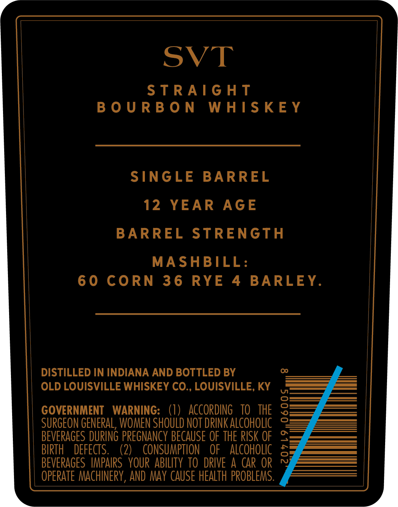
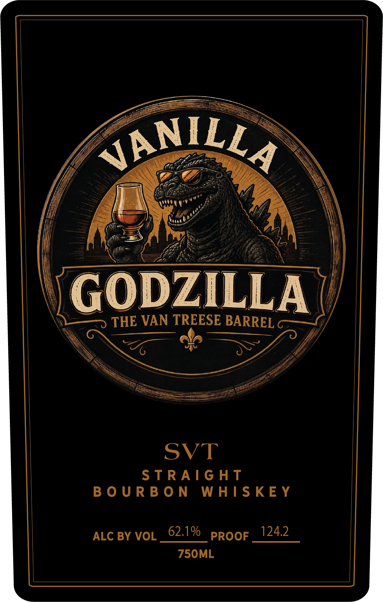

# TTB COLA Label Images - TTBID 26301001000562

**Brand Name:** VANILLA GODZILLA

**Issue Date:** 11/12/2026

**Origin Code:** 22

**Product Class/Type:** 101

**Source:** [TTB Public COLA Registry](https://ttbonline.gov/colasonline/viewColaDetails.do?action=publicFormDisplay&ttbid=26301001000562)

## Label Images

### Back Label

### Front Label

## Extracted Label Text

*Text extracted via OCR - may contain errors*

**Detected Proof:** 124.2
**Detected Age:** 12 Years

### Back Label

SVT

STRAIGHT

BOURBON WHISKEY

SINGLE BARREL

12 YEAR AGE

BARREL STRENGTH

MASHBILL:

60 CORN 36 RYE 4 BARLEY.

DISTILLED IN INDIANA AND BOTTLED BY

OLD LOUISVILLE WHISKEY CO., LOUISVILLE, KY

GOVERNMENT WARNING: (1) ACCORDING 10 THE

SURGEON GENERAL, WOMEN SHOULD NOT DRINK ALCOHOLIC

BEVERAGES DURING PREGNANCY BECAUSE OF THE RISK OF

BIRTH DEFECTS.

4)

CONSUMPTION OF ALCOHOLIC

BEVERAGES IMPAIRS YOUR ABILITY TO DRIVE A CAR OR

OPERATE MACHINERY, AND MAY CAUSE HEALTH PROBLEMS

### Front Label

JANILLA
GODZILLA
THE VAN TREESE BARREL
SVT
S TRA I G HT
B 0 U R B 0 N
WHIS KE Y
ALC BY VOL
62.1%
PROOF
124.2
750ML
