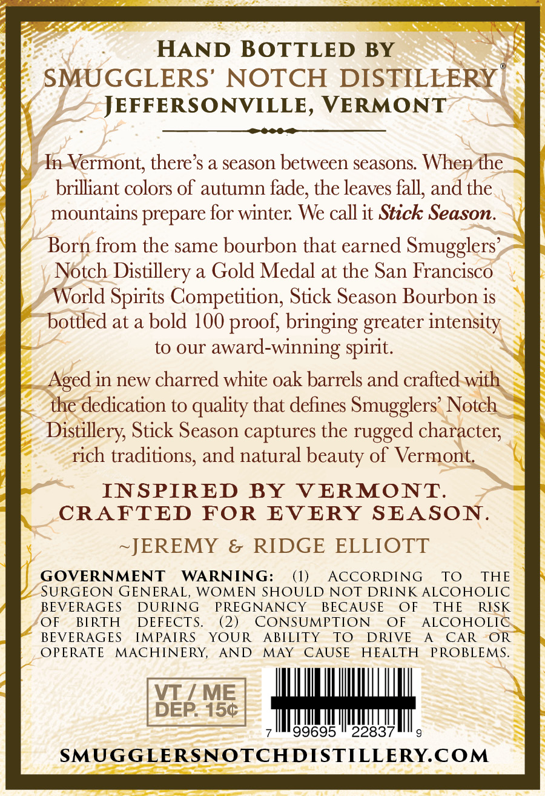
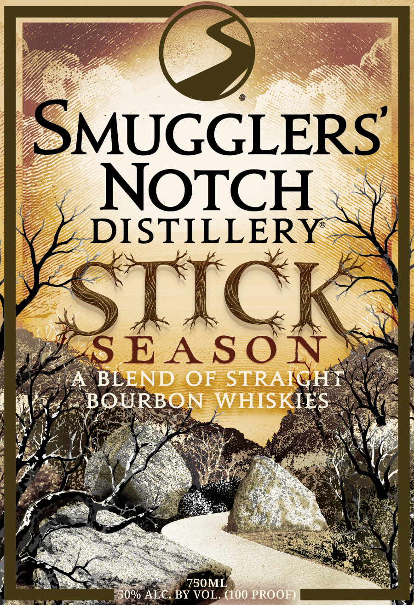

# TTB COLA Label Images - TTBID 26301001000599

**Brand Name:** SMUGGLERS' NOTCH

**Fanciful Name:** STICK SEASON

**Issue Date:** 11/02/2026

**Origin Code:** 46

**Product Class/Type:** 121

**Source:** [TTB Public COLA Registry](https://ttbonline.gov/colasonline/viewColaDetails.do?action=publicFormDisplay&ttbid=26301001000599)

## Label Images

### Back Label

### Front Label

## Extracted Label Text

*Text extracted via OCR - may contain errors*

**Detected Proof:** 100

### Back Label

HAND BOTTLED BY
SMUGGLERS' NOTCH DISTILLERY
JEFFER SONVILLE,
VERMONT
In Vermont; there s a season between seasons When the
brilliant colors of autumn fade; the leaves fall, and the
mountains prepare for winter We call it Stick Season.
Born from the same bourbon that earned Smugglers
Notch Distillery a Gold Medal at the San Francisco
World Spirits Competition, Stick Season Bourbon is
bottled at a bold 100 proof; bringing greater intensity
to our
award-winning spirit:
Aged in new charred white oak barrels and crafted with
the dedication to quality that defines Smugglers' Notch
Distillery Stick Season captures the rugged character;
rich traditions; and natural beauty of Vermont
INSPIRED BY
VERMONT:
CRAFTED
FOR
EVERY
SEASON_
~JEREMY
&
RIDGE ELLIOTT
GOVERNMENT
WARNING:
(1)
AccORDING
TO
THE
SURGEON GENERAL,
WOMEN SHOULD NOT DRINK ALCOHOLIC
BEVERAGES
DURING
PREGNANCY
BECAUSE
OF
THE
RISK
OF
BRTH
DEFECTS:
(2)
CONSUMPTION
OF
ALCOHOLIC
BEVERAGES
IMPAIRS
YOUR
ABILITY
TO
DRIVE
CAR
OR
OPERATE
MACHINERY,
AND
MAY
CAUSE
HEALTH
PROBLEMS;
VT
ME
DEP: 150
99695
22837
SMUGGLERSNOTCHDISTILLERY.COM

### Front Label

SMUGGLERS'
NOTCH
DISTILLERY
TICK
SEASO N
A
BLEND
OF
STRAIGHT
BOURBON
WHISKIES
750ML
50% ALC
BY VOL. (100 PROOF
