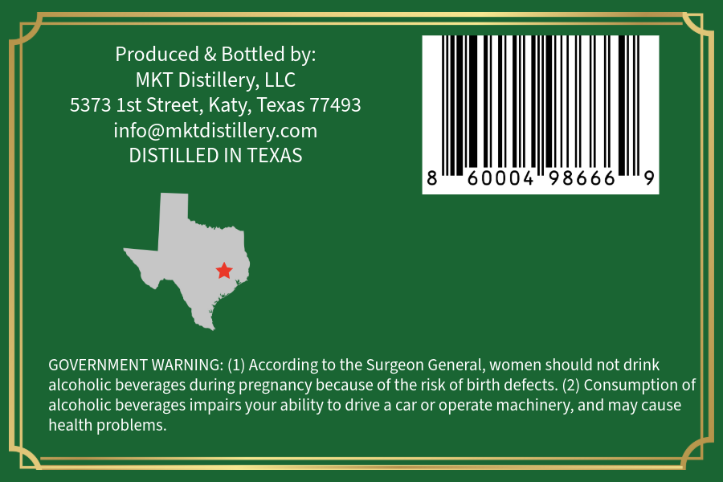
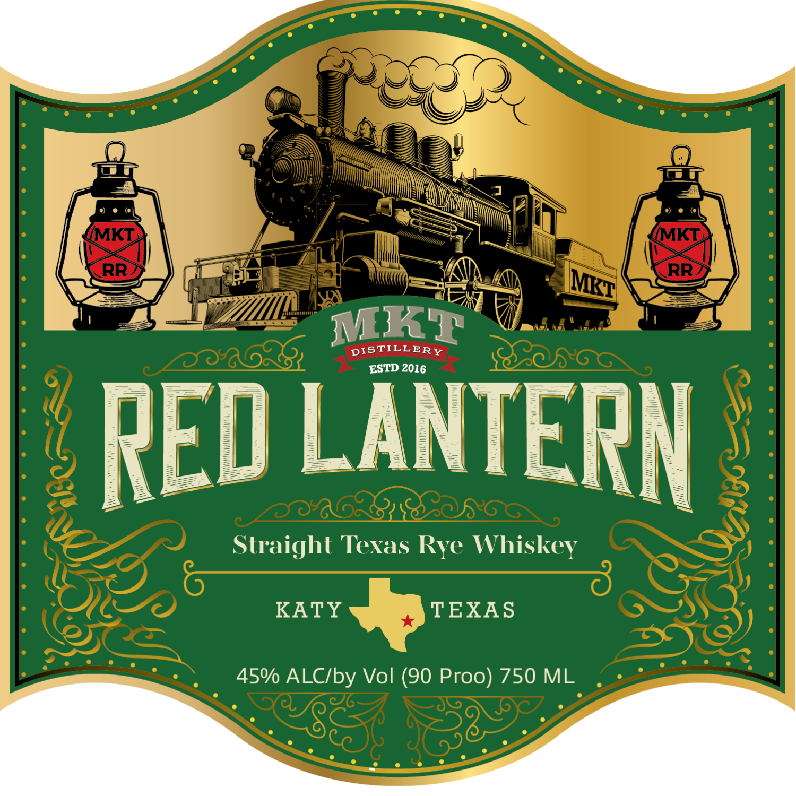

# TTB COLA Label Images - TTBID 26301001000671

**Brand Name:** RED LANTERN

**Issue Date:** 11/02/2026

**Origin Code:** 44

**Product Class/Type:** 102

**Source:** [TTB Public COLA Registry](https://ttbonline.gov/colasonline/viewColaDetails.do?action=publicFormDisplay&ttbid=26301001000671)

## Label Images

### Back Label

### Front Label

## Extracted Label Text

*Text extracted via OCR - may contain errors*

**Detected Proof:** 90

### Back Label

Produced & Bottled by:
MKT Distillery, LLC
5373 Ist Street, Katy, Texas 77493
info@mktdistillery com
DISTILLED IN TEXAS
60004
98666
GOVERNMENT WARNING: (1) According to the Surgeon General, women should not drink
alcoholic beverages during pregnancy because of the risk of birth defects: (2) Consumption of
alcoholic beverages impairs
ability to drive a car or operate machinery, and may cause
health problems:
your

### Front Label

(MKT
MKT
RR
RR
MKT
DISTILLERY
ESTD
RED LANTERN
Straighl Texas
Whiskey
KATY
TEXAS
45% ALCIby Vol (90 Proo) 750 ML
MKT
2016
Rye
