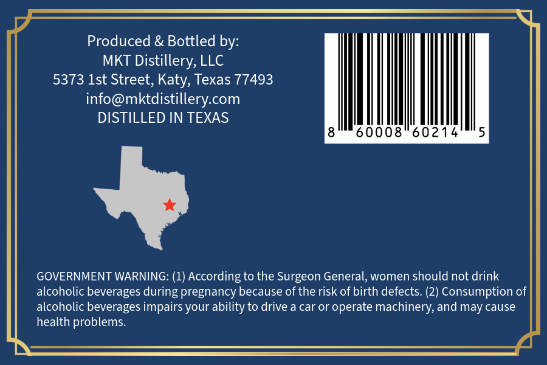
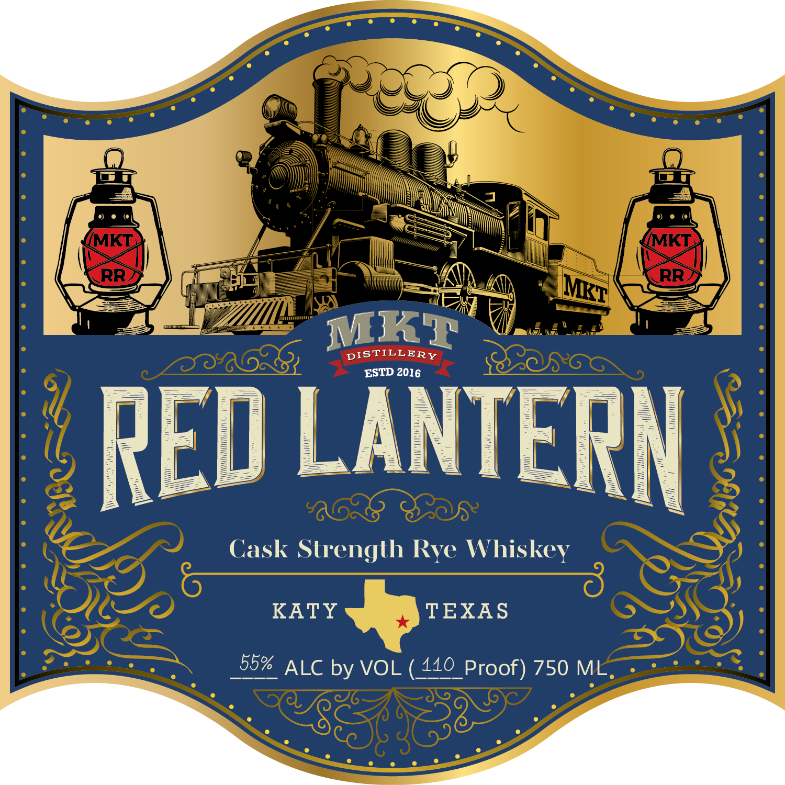

# TTB COLA Label Images - TTBID 26301001000684

**Brand Name:** RED LANTERN

**Fanciful Name:** CASK STRENGTH RYE WHISKEY

**Issue Date:** 11/04/2026

**Origin Code:** 44

**Product Class/Type:** 142

**Source:** [TTB Public COLA Registry](https://ttbonline.gov/colasonline/viewColaDetails.do?action=publicFormDisplay&ttbid=26301001000684)

## Label Images

### Back Label

### Label 1

## Extracted Label Text

*Text extracted via OCR - may contain errors*

**Detected Proof:** 110

### Back Label

Produced & Bottled by:
MKT Distillery, LLC
5373 Ist Street, Katy, Texas 77493
info@mktdistillerycom
DISTILLED IN TEXAS
60008
60214
GOVERNMENT WARNING: (1) According to the Surgeon General, women should not drink
alcoholic beverages during pregnancy because of the risk of birth defects: (2) Consumption of
alcoholic beverages impairs your ability to drive a car or operate machinery, and may cause
health problems

### Label 1

(MKT
MMKT
RR
RR
MKT
DISTILLERY
ESTD 2016
RED LANTERN
Cask Strenglh Rye Whiskey
KATY
TEXAS
55%
ALC by VOL
4110_Proof) 750 ML
MKT
