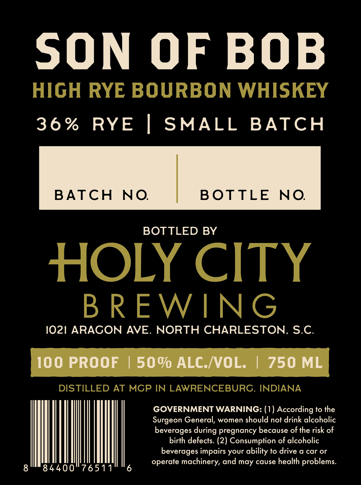
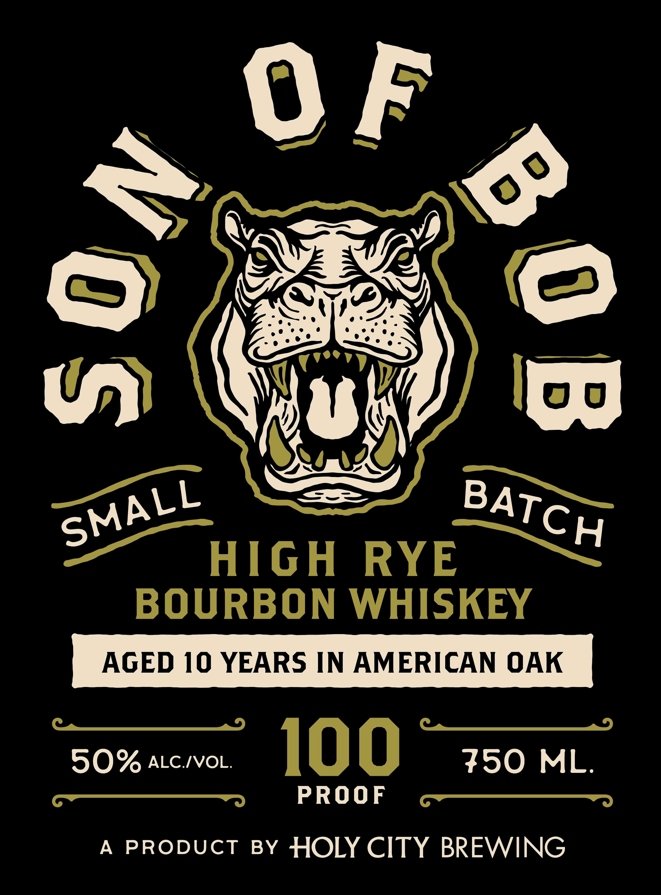

# TTB COLA Label Images - TTBID 26302001000081

**Brand Name:** HOLY CITY BREWING

**Fanciful Name:** SON OF BOB

**Issue Date:** 11/03/2026

**Origin Code:** 41

**Product Class/Type:** 141

**Source:** [TTB Public COLA Registry](https://ttbonline.gov/colasonline/viewColaDetails.do?action=publicFormDisplay&ttbid=26302001000081)

## Label Images

### Back Label

### Front Label

## Extracted Label Text

*Text extracted via OCR - may contain errors*

**Detected Proof:** 100
**Detected Age:** 10 Years

### Back Label

SON
OF BOB
HIGH
RYE BOURBON WHISKEY
3 6 %
RYE
SMALL
BATCH
BATCH
NO
BOTTLE
NO
BOTTLED BY
HOLY CITY
B R EWING
1021 ARAGON
AVE.
NORTH CHARLESTON; S.C.
100 PROOF
1500 ALC NOL:
750 ML
DISTILLED
AT MGP IN LAWRENCEBURG. INDIANA
GOVERNMENT WARNING: (1) According to the
Surgeon General, women should not drink alcoholic
beverages during pregnancy because of the risk of
birth defects. (2) Consumption of alcoholic
beverages impairs your ability to drive a car or
operate machinery, and may cause health problems:
8
84400
76511
6

### Front Label

0) /5
U))
0 0
HIGH
RYE
BOURBON WHISKEY
AGED 10 YEARS IN AMERICAN OAK
50% ALC /VOL:
100
750
ML.
PROOF
A
PRODUct
BY HOLY CITY BREWING
) 0
SMALL
BATCH
