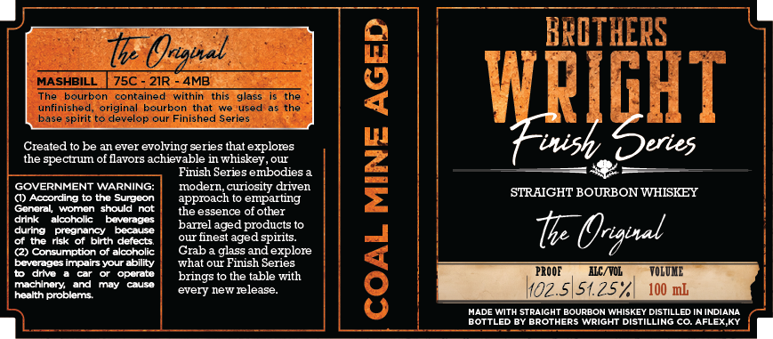

# TTB COLA Label Images - TTBID 26302001000087

**Brand Name:** BROTHERS WRIGHT

**Fanciful Name:** THE ORIGINAL

**Issue Date:** 11/03/2026

**Origin Code:** 22

**Product Class/Type:** 101

**Source:** [TTB Public COLA Registry](https://ttbonline.gov/colasonline/viewColaDetails.do?action=publicFormDisplay&ttbid=26302001000087)

## Label Images

### Label 1

## Extracted Label Text

*Text extracted via OCR - may contain errors*

### Label 1

KRCTHERS
MASHBILL
t
75C
Ozgbal_
21R
4MB
8
The
bourbon
contained
within
this
glass
is the
unfinishit torginalopouf Pinished
seriesed
the
WpighT
Created to be an ever evolving series that explores
t-wish
the spectrum of flavors achievable in whiskey _
Finish Series embodies
1
GOVERNMENT WARNING:
modern curiosity driven
(I) According t0 the Surgeon
approach to emparting
STRHIGHT BOURBON WHISKEY
(Cene
Wantcn
should not
the essence ofother
drnk
alcoholk
baverages
during
pteamang
because
burtnegegecospicis .
t Ongval
of the risk of birth defects
(2) Consumption of alcoholic
Grab
glass and explore
beverages impairsyour ability
what our Finish Series
dnve
opcrate
brings tO the table with
8
PROOF
HIC/VOL
TOLUXE
machlnery:
and
may
Causa
every nlew ielease:
koz.5/51.25%
100 mb
heatth problers
HADE With StraIGHT BOURBON WHISKEY DISTILLED ININDIANA
BOTTLED BY BROTHERS WRIGHT
DistlLinG C0
AFLEX KY
Our
aged)
