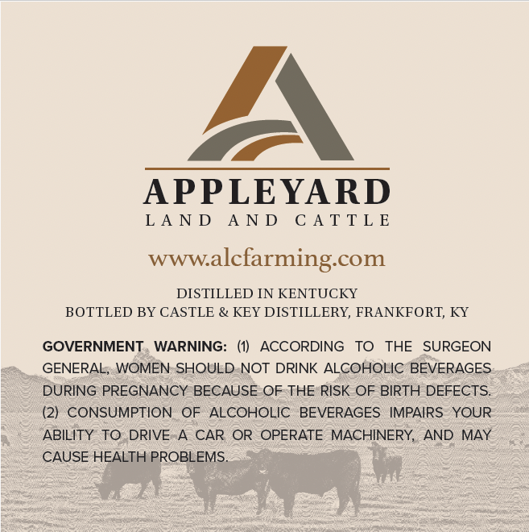
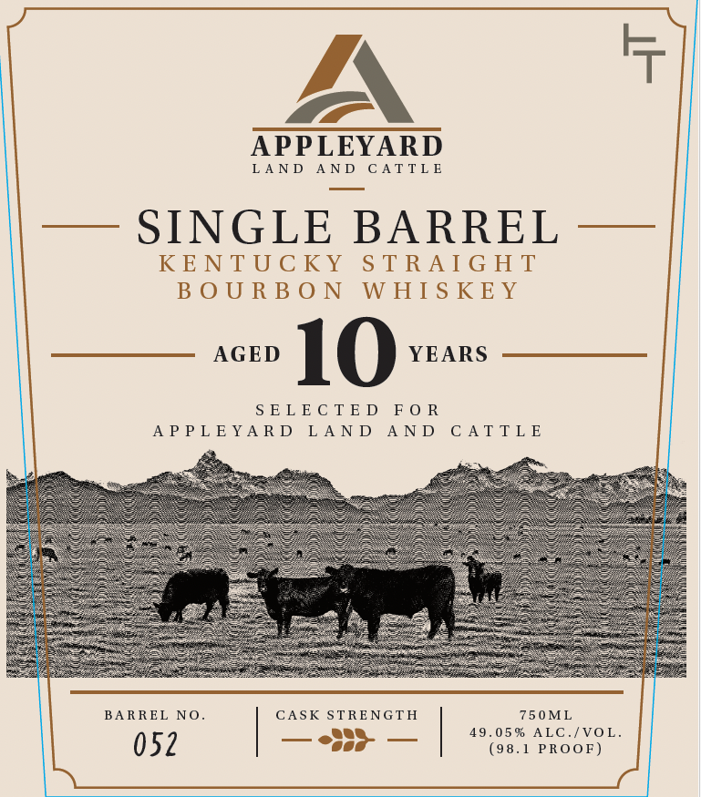

# TTB COLA Label Images - TTBID 26302001000251

**Brand Name:** APPLEYARD

**Issue Date:** 11/03/2026

**Origin Code:** 22

**Product Class/Type:** 101

**Source:** [TTB Public COLA Registry](https://ttbonline.gov/colasonline/viewColaDetails.do?action=publicFormDisplay&ttbid=26302001000251)

## Label Images

### Back Label

### Front Label

## Extracted Label Text

*Text extracted via OCR - may contain errors*

### Back Label

APPLEYARD
LA N D
A N D
C A T TL E
wwwalcfarming com
DISTILLED IN KENTUCKY
BOTTLED BY CASTLE & KEY DISTILLERY, FRANKFORT, KY
GOVERNMENT
WARNING: (1)
AcCORDING
TO
THE
SURGEON
GENERAL, WOMEN SHOULD NOT DRINK ALCOHOLIC BEVERAGES
DURING PREGNANCY BECAUSE OF THE RISK OF BIRTH DEFECTS.
(21 CONSUMPTION
OF
ALCOHOLIC   BEVERAGES IMPAIRS YOUR
ABILITY TO DRIVE
CAR OR OPERATE MACHINERY, AND MAY
CAUSE HEALTH PROBLEMS.

### Front Label

PAN
APPLEYARD
LAND AND CATTLE
KENTUCKY STRAIGHT
BOURBON WHISKEY
—— AGED 1 O YEARS ————————_
SELECTED FOR
APPLEYARD LAND AND CATTLE
BARREL NO. CASK STRENGTH 750ML
052 | eth | anges ttewon
