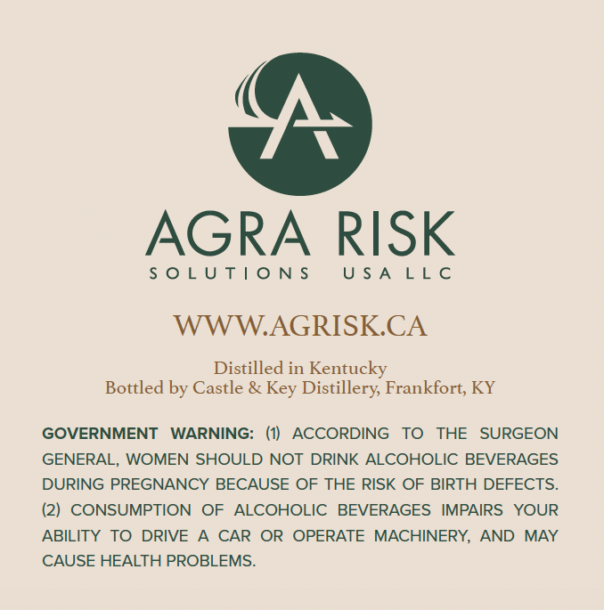
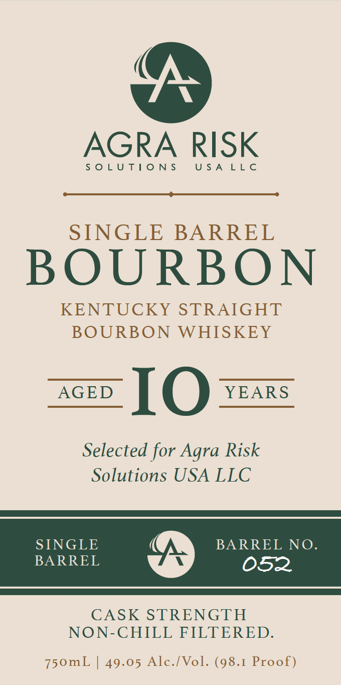

# TTB COLA Label Images - TTBID 26302001000255

**Brand Name:** AGRA RISK

**Issue Date:** 11/03/2026

**Origin Code:** 22

**Product Class/Type:** 101

**Source:** [TTB Public COLA Registry](https://ttbonline.gov/colasonline/viewColaDetails.do?action=publicFormDisplay&ttbid=26302001000255)

## Label Images

### Back Label

### Front Label

## Extracted Label Text

*Text extracted via OCR - may contain errors*

**Detected Proof:** 98.1

### Back Label

AGRA RISK

SOLUTIONS

USALLC

WWW.AGRISK.CA

Distilled in Kentucky

Bottled by Castle & Key Distillery, Frankfort, KY

GOVERNMENT WARNING: (1) ACCORDING TO THE SURGEON

GENERAL, WOMEN SHOULD NOT DRINK ALCOHOLIC BEVERAGES

DURING PREGNANCY BECAUSE OF THE RISK OF BIRTH DEFECTS.

(2) CONSUMPTION OF ALCOHOLIC BEVERAGES IMPAIRS YOUR

ABILITY TO DRIVE A CAR OR OPERATE MACHINERY, AND MAY

CAUSE HEALTH PROBLEMS.

### Front Label

(

AGRA RISK

SOLUTIONS USALLC

SINGLE BARREL

BOURBON

KENTUCKY STRAIGHT
BOURBON WHISKEY

AGED IO YEARS

Selected for Agra Risk
Solutions USA LLC

SINGLE BARREL NO.
BARREL 052

CASK STRENGTH
NON-CHILL FILTERED.

750mL | 49.05 Alc./Vol. (98.1 Proof)
