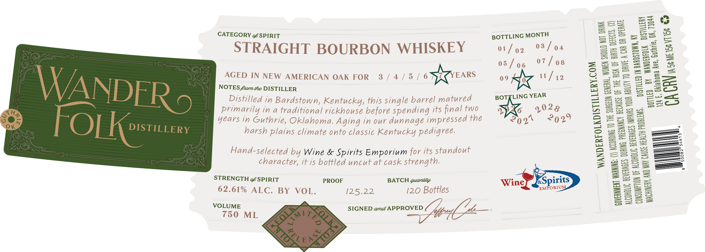

# TTB COLA Label Images - TTBID 26302001000596

**Brand Name:** WANDERFOLK DISTILLERY

**Issue Date:** 11/09/2026

**Origin Code:** 37

**Product Class/Type:** 101

**Source:** [TTB Public COLA Registry](https://ttbonline.gov/colasonline/viewColaDetails.do?action=publicFormDisplay&ttbid=26302001000596)

## Label Images

### Label 1

## Extracted Label Text

*Text extracted via OCR - may contain errors*

### Label 1

CATEGORY ¢/SPIRIT

STR
AIGHT BOURBON WHISKEY

Distilled 1,
ISTINed In Bardste
Primarily in stown, Kentuck a
a traditi » th
years in Luh oh napus ae matured
harsh plains cli oma. Aging in our danna ing Its final two
imate onto classic hie eh the
gree.

Hand-sel te
Y Wine Spiri S Emporium ov its stan
ou

character, it Is bott
» It is bottled
—— uncut at cask strength.

62.61% =
; ALE HY WOR. OF BATCH quantity
= 125.22) 120 Bottles

750 M ae
L SIGNED amd APPROVED

BOTTLING MONTH

01/2 03/94
05/06 07/08

09 Ne 11/49

BOTZLING YEAR
WX 1928

202% 2929

wing

COM

WOM

STILLERY.

AGEDN GENERAL,

WANDERFOLKD!

WARING: (I)

NK

EN SHOULD NOT DRI

N
tt

ACCORDING 10 TH

GOVERNMEN

(18. (2)

ISK OF BIRTH DEtE!

CAUSE OF THE A

QR OPERATE

iN

DRIVE A CAR

ABILITY

IRS YOU

IW BARDSTOWN
WANDERFOLK

DISTILLED

AND MAY CALS

MACHINERY,

ULERY
T3044
&

psi
Guthrie, OK,
DA] seme tev

BY
klahoma Ave,

BOTTLED
4b. 0
CAC

I

)

|

I
