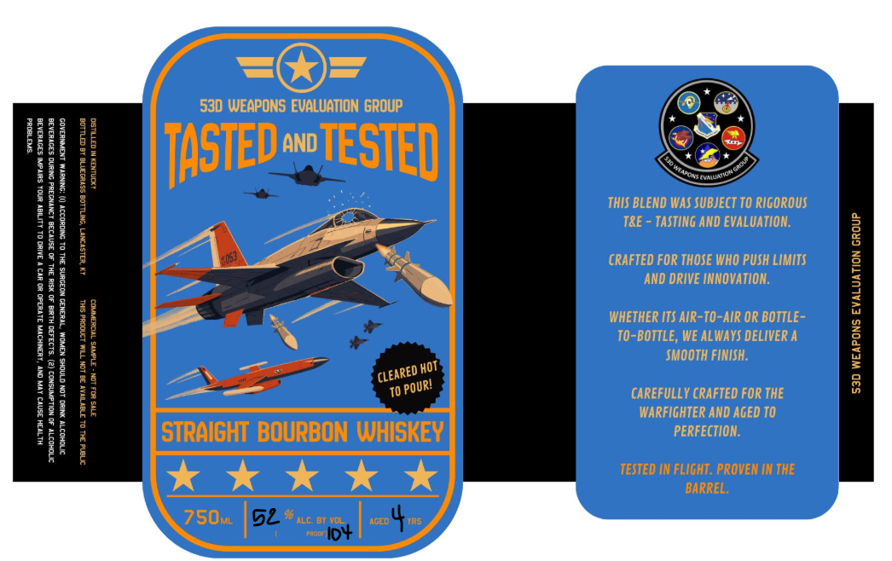

# TTB COLA Label Images - TTBID 26302001000604

**Brand Name:** 53D WEAPONS EVALUATION GROUP

**Issue Date:** 11/03/2026

**Origin Code:** 22

**Product Class/Type:** 101

**Source:** [TTB Public COLA Registry](https://ttbonline.gov/colasonline/viewColaDetails.do?action=publicFormDisplay&ttbid=26302001000604)

## Label Images

### Label 1

## Extracted Label Text

*Text extracted via OCR - may contain errors*

### Label 1

530 WEAPONS EVALUATION GROUP
II
1
ITASTEDE
AND
TESTED
"

H

THIS BLEND WS SUBJECT TO RUGoRous
TRE
TASTINg AND EVALUATIoN:

1
3
CRAFTED FOR THOSE WHO PUSH LIMITS
[

AND DRIVE NNOVATION:
1
1
1

WHETHER ITS AIR-TO-AIR OR BOTTLE =
1
'
1
TO-BOTTLE, WE ALWAYS DELIVER A
1
0
SMOOTH FINISH.
HOT
U
E
CAREFULLY CRAFTED FOR THE
8
2
[
Wi
Warfighter ANd AgED TO
96|
STRAIGHT BOURBON WHISKEY
PERFECTION.
TESTED IN FLIGHT. PROVEN IN THE
BARREL;
750mL
52
ALC D1 Vel
AGED
'CLEARED E
) POURI
~Peoor IDy
