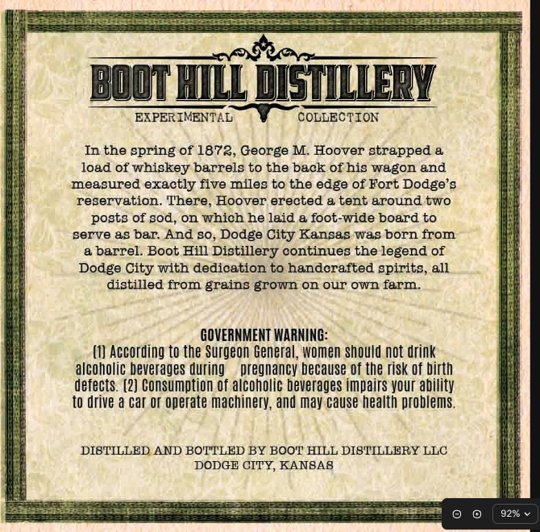
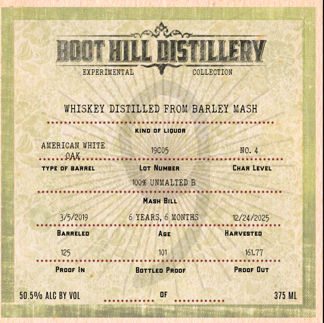

# TTB COLA Label Images - TTBID 26302001000676

**Brand Name:** BOOT HILL DISTILLERY WHISKEY FROM A BARLEY MASH

**Issue Date:** 11/09/2026

**Origin Code:** 21

**Product Class/Type:** 140

**Source:** [TTB Public COLA Registry](https://ttbonline.gov/colasonline/viewColaDetails.do?action=publicFormDisplay&ttbid=26302001000676)

## Label Images

### Back Label

### Label 1

## Extracted Label Text

*Text extracted via OCR - may contain errors*

**Detected Proof:** 161.8

### Back Label

bodttdsiy
EXPER IMENTAL
COLLECTION
In the spring of 1873, George M.
Hoover strapped &
load of whiskey barrels to the back of his wagon and
meagured exactly five miles to the edge of Fort Dodge's
reservation. There,
Hoover erected & tent around two
posts of sod,
on
which he laid
foot-wide board to
serve a8 bar: And 80,
Dodge
Kansas was born from
a barrel  Boot Hill Distillery continues the legend of
Dodge City with dedication to handcrafted spirits, all
distilled from grains grown on our own farm.
GOVERNMENT WARNING:
According to the Surgeon General, women should not drink
alcoholic beverages during
pregnancy because Of the risk Of birth
defects . (2) Consumption Of alcoholic beverages impairs your ability
to drive a car Or operate machinery; and may cause health problems.
DIBTILLED AND BOTTLED BY BOOT HILL DIBTILLERY LLC
DODGE CITY KANBAB
9296
City

### Label 1

bodiTLD6RY
EXPERIKEFTAL
COLLECTION
WHISKEY DISTILLED FROM BARLEY MASH
KIND OF Liquor
AKERICAN WHITE
13C05
QAK
TYPE OF
BARREL
Lot NuMBER
CHAR LEVEL
100% UNMALTED 6
MASH BILL
3/5/2019
YEARS_
MONTHS
12/24/2025
BARRELED
AGE
HARVESTED
161.77
Proof
BoTTLED Proof
Proof Out
50.50/ AlC BY VOL
375 ML
