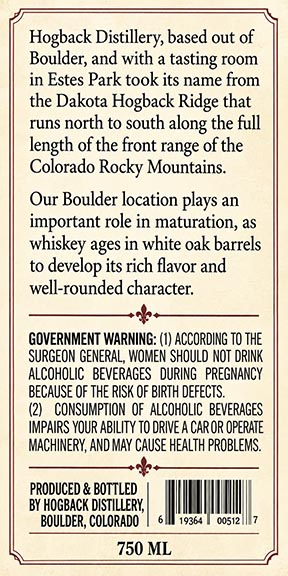
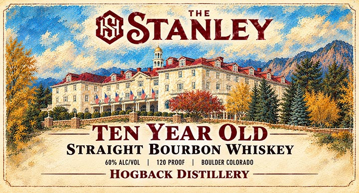

# TTB COLA Label Images - TTBID 26302001000708

**Brand Name:** HOGBACK DISTILLERY

**Fanciful Name:** THE STANLEY

**Issue Date:** 11/09/2026

**Origin Code:** 13

**Product Class/Type:** 101

**Source:** [TTB Public COLA Registry](https://ttbonline.gov/colasonline/viewColaDetails.do?action=publicFormDisplay&ttbid=26302001000708)

## Label Images

### Back Label

### Front Label

## Extracted Label Text

*Text extracted via OCR - may contain errors*

**Detected Proof:** 120

### Back Label

Hogback Distillery, based out of
Boulder; and with
tasting room
in Estes Park took its name from
the Dakota Hogback Ridge that
runs
north to south
the full
length of the
range ofthe
Colorado Rocky Mountains.
Our Boulder location plays an
important role in maturation, as
whiskey ages in white oak barrels
its rich flavor and
well-rounded character;
GOVERNMENT WARNING:
ACCORDING TO the
SURGEON GENERAL, WOMEN ShoULD NOT DRINK
AlcohOLIC;   BEVERAGES   DURING   PREGNANCY
BECAUSE OF THE RISK OF BIRTH deFECTS.
COMSUMPTION  OF  ALCOHOLIC  BeVeRAGeS
IMPAIRS YOUR AbilIty TO dRIVE A CaROR OpeRATE
MACHINERY, AND MAY Cause health pROBLEMS.
PRODUCED & BOTTLED
BY HOGBACK DISTILLERY;
BOULdeR, COLORADO
19364
61312
750 ML
along `
front
develop

### Front Label

THE
STANLEY
TEN YEAR OLD
STRAIGHT BOURBON WHISKEY
60% ALC/VOL
120 PROOF
BOULdeR COLORADO
HOGBACK DISTILLERY
