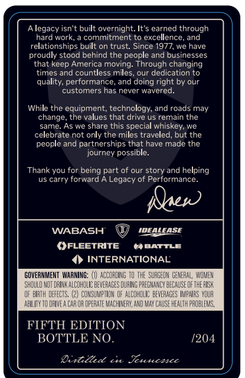
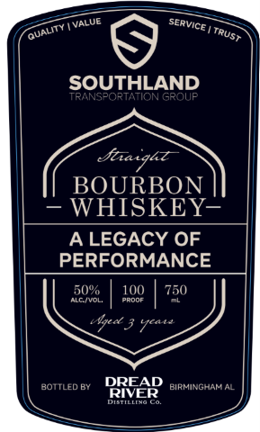
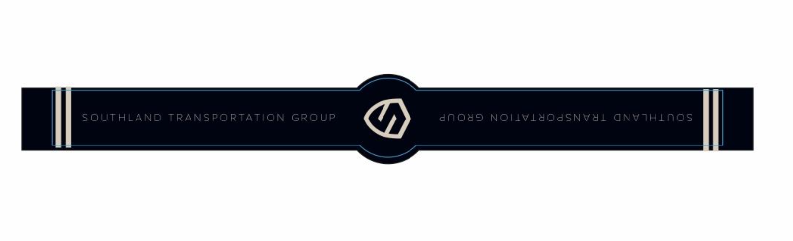

# TTB COLA Label Images - TTBID 26302001000749

**Brand Name:** DREAD RIVER DISTILLING CO.

**Fanciful Name:** STG SINGLE BARREL 2026

**Issue Date:** 11/12/2026

**Origin Code:** 10

**Product Class/Type:** 101

**Source:** [TTB Public COLA Registry](https://ttbonline.gov/colasonline/viewColaDetails.do?action=publicFormDisplay&ttbid=26302001000749)

## Label Images

### Back Label

### Front Label

### Label 3

## Extracted Label Text

*Text extracted via OCR - may contain errors*

### Back Label

legacy isn't built overnight. It' $ earned through
hard work,
commitment to excellence
and
relationships built on trust. Since 1977, we have
proudly stood behind the people
businesses
that keep America moving: Through changing
times and countless miles
our dedication to
quality; performance_
and doing right by our
customers has never wavered.
While the equipment, technology; and roads may
change, the values that drive us remain the
same
As we share this special whiskey; we
celebrate not only the miles traveled_
but the
people and partnerships that have made the
journey possible_
Thank you for being part of our story and helping
carry forward A Legacy of
Performance.
Aen
WABASH
IDEALEASE
OFLEETRITE
KBattle
INTERNATIONAL
GOVERMMENT  WARNING: (€)  ACCOFDING TO THE   SURGEON GENERAL,  YNOMEM
SHOULD WOT DRLK ALCOHOLIC BEVERAGES DURING PRECMHNCY BECAUSE OF THE RLSK
QF Blath DEFECs,
COMSUMPTLON OF ALCDHCLC BEVERAGES |PAFS Youa
ABL|TY TO dALve 4 CAR OA dpeRATE WACHNERY, AND WAY ChUSe HEaLtH PROBLEIS,
FIFTH EDITION
BOTTLE NO.
1204
Diiec
Jesutenee
and

### Front Label

SOUTHLAND
TRANSPORTATION GROUP
fuatgaz
BOURBON
WHISKEY
A LEGACY OF
PERFORMANCE
50"0
100
750
Ada
MAge&t 3 'y{ca12
BOTTLED BY
DREAD
BIRMINGHAMAL
RIVER
UETLLCO
Value
scavice
QUALMY E
trust

### Label 3

SOUTHLAND TRANSPORTATION GROUP
dnodo NoivaodSNVal JNVhInOS
