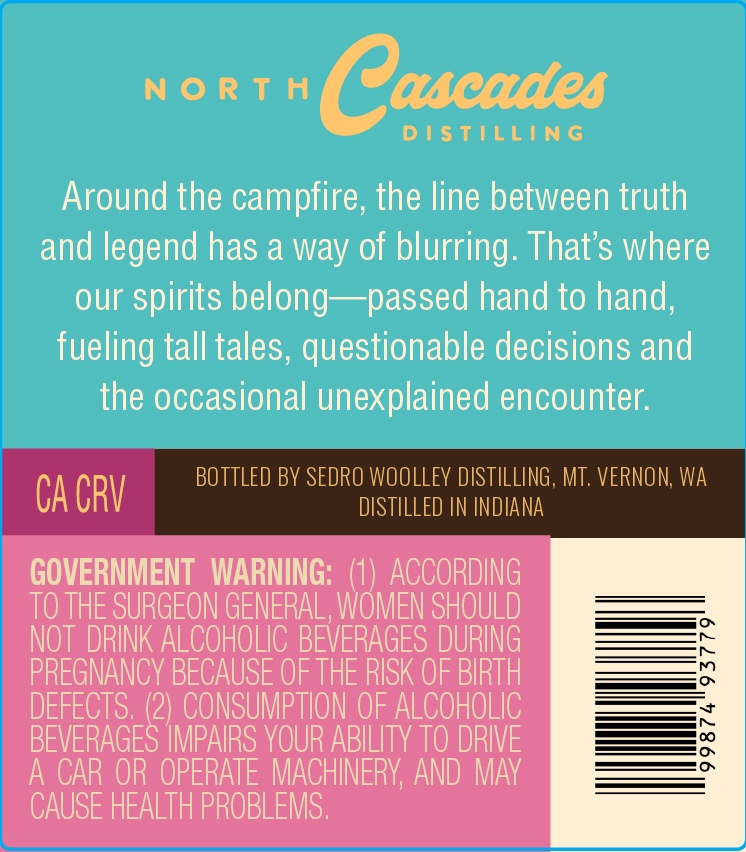
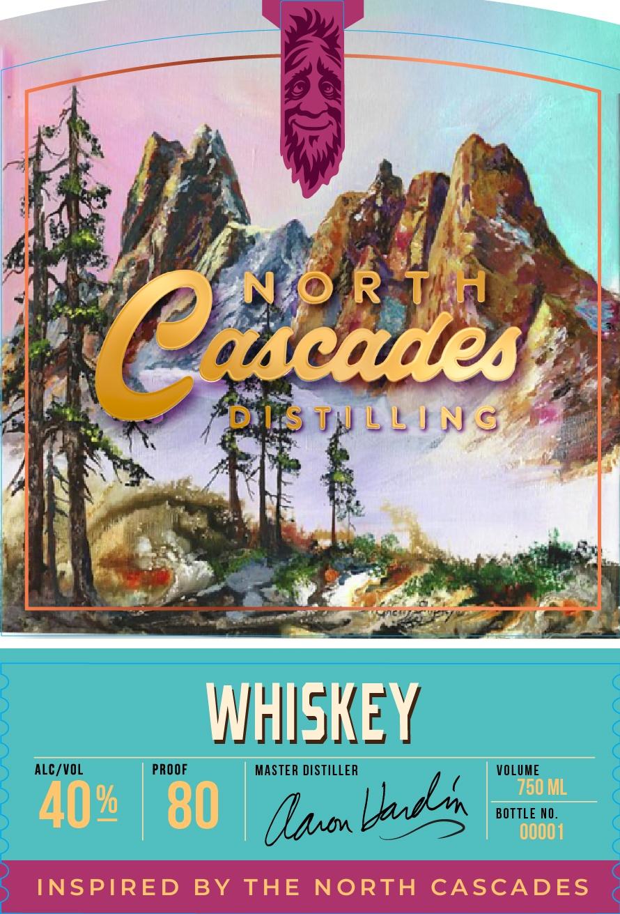

# TTB COLA Label Images - TTBID 26302001000750

**Brand Name:** NORTH CASCADES DISTILLING

**Issue Date:** 11/06/2026

**Origin Code:** 07

**Product Class/Type:** 140

**Source:** [TTB Public COLA Registry](https://ttbonline.gov/colasonline/viewColaDetails.do?action=publicFormDisplay&ttbid=26302001000750)

## Label Images

### Back Label

### Front Label

### Label 3

## Extracted Label Text

*Text extracted via OCR - may contain errors*

### Back Label

N 0 Rt H
Cascades
D I StiLinG
Around the campfire, the line between truth
and legend has a way of blurring: That $ where
our
spirits belong
~passed hand to hand,
fueling tall tales, questionable decisions and
the occasional unexplained encounter:
BOttled BY SEDRO wooLLeY DISTILLING , MT. VERNON; Wa
CA CRV
DISTILLED IN INDIANA
GOVERNMENT   WARNING:
ACCORDING
TO THE SURGEON GENERAL, WOMEN SHOULD
NOT DRINK ALCOHOLIC BEVERAGES DURING
PREGNANCY BECAUSE OF THE RISK OF BIRTH
DEFECTS, (2) CONSUMPTION OF ALCOHOLIC
BEVERAGES IMPAIRS YOUR ABILITY TO DRIVE
0
A CAR OR OPERATE MACHINERY, AND MAy
CAUSE HEALTH PROBLEMS ;

### Front Label

Wii SNE J,

ALC/VOL PROOF MASTER DISTILLER VOLUME

G
palm BOTTLE NO.
=

INSPIRED BY THE NORTH CASCADES

### Label 3

(6)
o

THE RANGE AWAITS 5 SLIVMV JONVd4 SHL
tv
