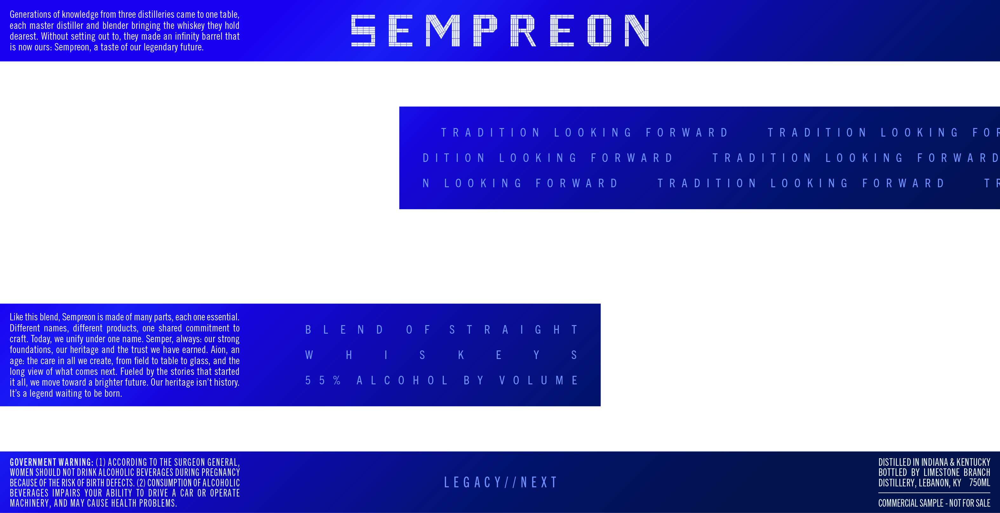

# TTB COLA Label Images - TTBID 26303001000077

**Brand Name:** SEMPREON

**Issue Date:** 11/17/2026

**Origin Code:** 29

**Product Class/Type:** 129

**Source:** [TTB Public COLA Registry](https://ttbonline.gov/colasonline/viewColaDetails.do?action=publicFormDisplay&ttbid=26303001000077)

## Label Images

### Label 1

### Label 2

## Extracted Label Text

*Text extracted via OCR - may contain errors*

*1 image(s) excluded: text did not meet readability threshold*

### Label 1

Generations of knowledge from three distilleries came to one table
each master distiller and blender bringing the whiskey they hold
dearest  Without setting out to, they made an infinity barrel that
SEMPREON
is nOw ours: Sempreon; a taste of our legendary future:
T R A D | T | 0 N
L 0 0 K | N G
F 0 R W A R D
T R A D | T | 0 N
L 0 0 K | N G
F 0 F
D | T | 0 N
L 0 0 K | N G
F 0 R W A R D
T R A D / T | 0 N
L 0 0 K | N G
F 0 R W A R D
N L 0 0 K | N G
F 0 R W A R D
T R A D | T | 0 N
L 0 0 K / N G
F 0 R W A R D
T F
Like this blend, Sempreon is made of
parts, each one essential.
Different names, different products,
one shared commitment to
B L E N D
0  F  $ T R A | G h T
craft: Today; we unify under one name. Semper; always: our strong
foundations, our
heritage and the trust we have earned . Aion, an
age: the care in all we create, from field to table to glass, and the
W  H |  s  K  E  Y
S
long view of what comes next: Fueled by the stories that started
it all, we move toward a brighter future. Our heritage isn't history:
5  5 %
A L € 0 H 0 L B Y V 0 L U M E
Its a legend waiting to be born:
GOVERNMENT WARNING: (1) ACCORDING TO THE SURGEON GENERaL,
DISTILLED IN INDIANA & KENTuCKY
WOMEN SHOULD NOT DRINK ALCOHOLIC BEVERAGES DURING preGNancy
BOTTLED BY  LIMESTONE BRANCH
BECAUSE OF THE RISK OF BIRTH DEFECTS. (2) CONSUMPTION OF alcoholic
LE G A € Y / / N EXT
DISTILLERY, LEBANON, KY
750ML
BEVERAGES IMPAIRS YOUR abiLITy TO DRIVE A CAR OR OPERATE
MachINERY, ANd May CAUSE hEalth PROBLEMS.
COMMERCIAL SAMPLE - NOT FOR SALE
many
