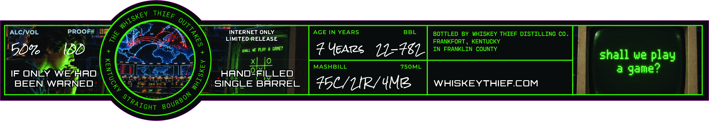
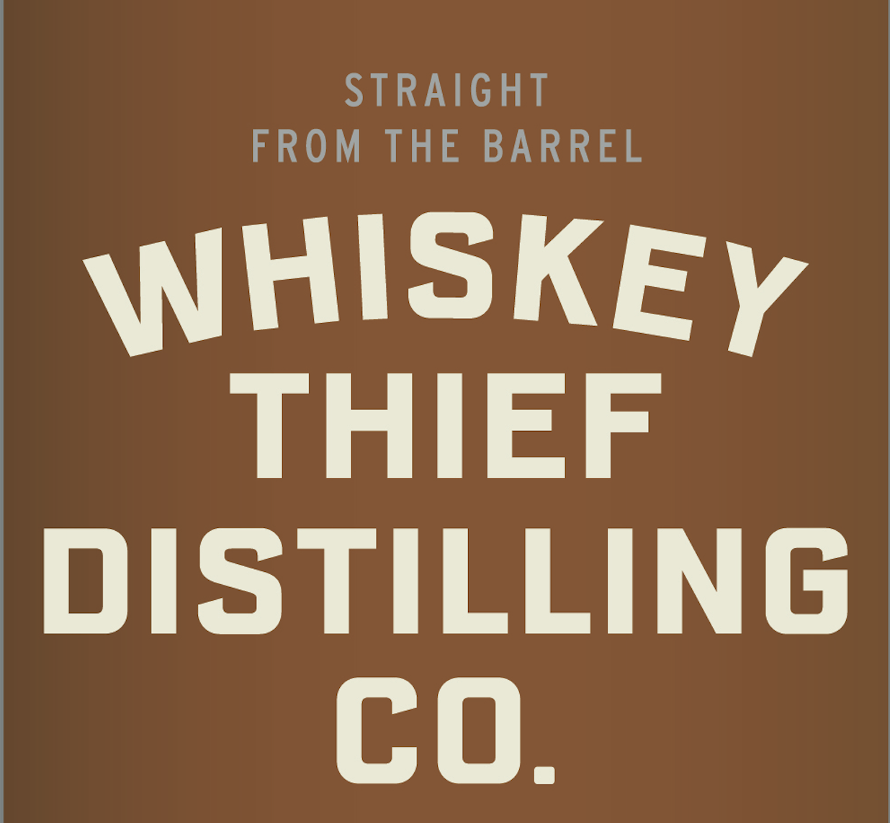
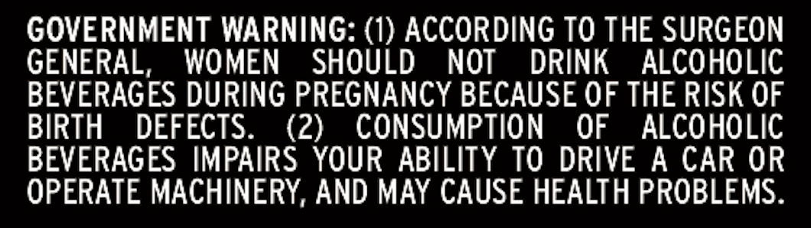

# TTB COLA Label Images - TTBID 26303001000128

**Brand Name:** WHISKEY THIEF DISTILLING CO.

**Fanciful Name:** WAR GAMES

**Issue Date:** 11/03/2026

**Origin Code:** 22

**Product Class/Type:** 101

**Source:** [TTB Public COLA Registry](https://ttbonline.gov/colasonline/viewColaDetails.do?action=publicFormDisplay&ttbid=26303001000128)

## Label Images

### Front Label

### Label 2

### Label 3

### Label 4

## Extracted Label Text

*Text extracted via OCR - may contain errors*

### Front Label

ALCIvoL
PROOFS
INTERNET ONLY
AGE IN YEARS
BBL
BOTTLED
BY
WHISKEY THIEF DISTILLING CO
LIMITED RELEASE
FRANKFORT
KENTUCKY
50v
SHALL WE PLAY A
GAME?
UEATZS
11-48
IN
FRANKLIN
COUNTY
shall we play
xHo
MASHBILL
750ML
a
game?
IF ONLY WEHAD
HANDPFILLED
BEEN
WARNED
SINGLE BARREL
4501P/4Mz
WHISKEYTHIEFCOM
THIEF
WHISKEY
1
4
(
1
BOURBON
STRAIGHT

### Label 2

STRAIGHT
FROM
THE
BARREL
WHISKEY
THIEF
DISTILLING
co.

### Label 3

888
MonnaX
THE
1
1
1
Lemintiuli
L
ieteeant
8
SaXv)
WHISKEY

### Label 4

GOVERNMENT WARNING: (1) ACCORDING TO THE SURGEON

GENERAL, WOMEN SHOULD NOT DRINK ALCOHOLIC

BEVERAGES DURING PREGNANCY BECAUSE OF THE RISK OF

BIRTH DEFECTS.

(2) CONSUMPTION OF ALCOHOLIC

BEVERAGES IMPAIRS YOUR ABILITY TO DRIVE A CAR OR

OPERATE MACHINERY, AND MAY CAUSE HEALTH PROBLEMS.
