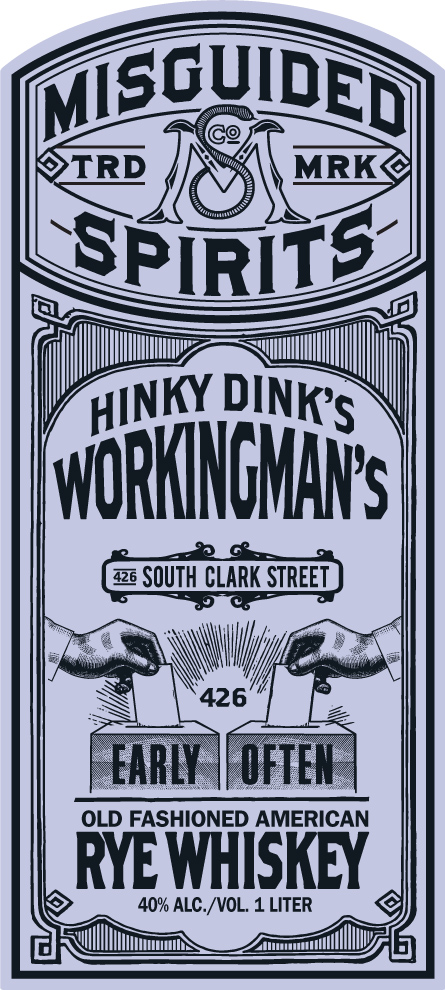
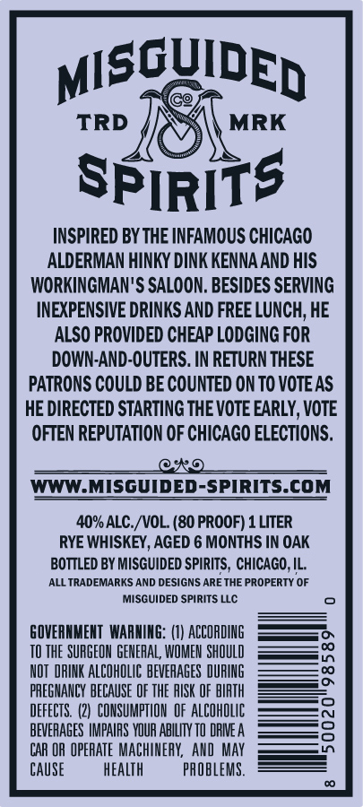

# TTB COLA Label Images - TTBID 26303001000134

**Brand Name:** MISGUIDED SPIRITS

**Fanciful Name:** HINKY DINK'S WORKINGMAN'S OLD FASHIONED AMERICAN RYE WHISKEY

**Issue Date:** 11/06/2026

**Origin Code:** 04

**Product Class/Type:** 142

**Source:** [TTB Public COLA Registry](https://ttbonline.gov/colasonline/viewColaDetails.do?action=publicFormDisplay&ttbid=26303001000134)

## Label Images

### Front Label

### Label 2

## Extracted Label Text

*Text extracted via OCR - may contain errors*

**Detected Proof:** 80

### Front Label

MSqUDEDI
TRD
MRK
SPiRITs
WORHNCHHS
426
SOUTH CLARK STREET
426
EARLY
OFTEN
OLD FASHIONED AMERICAN
RYEWHISKEY
40% ALC./VOL. 1 LITER
DINKS
HINKY _

### Label 2

MISGUIDED
TRD
MRK
spirits
INSPIRED BY THE INFAMOUS CHICAGO
ALDERMAN HINKY DINK KENNA AND HIS
WORKINGMAN'S SALOON, BESIDES SERVING
INEXPENSIVE DRINKS AND FREE LUNCH; HE
ALSO PROVIDED CHEAP LODGING FOR
DOWN-AND-OUTERS. IN RETURN THESE
PATRONS COULD BE COUNTED ON TO VOTE AS
HE DIRECTED STARTING THE VOTE EARLY; VOTE
OFTEN REPUTATION OF CHICAGO ELECTIONS.
@S0
WWW.MISGUIDED-SPIRITS.COM
40% ALC /VOL: (80 PROOF) 1 LITER
RYE WHISKEY, AGED 6 MONTHS IN OAK
BOTTLED BY MISGUIDED SPIRITS , CHICAGO, IL:
ALL TRADEMARKS AND DESIGNS ARE THE PROPERTY OF
MISGUIDED SPIRITS LLC
GOVERNMEHT  WARNING: (I) ACCORDING
TO THE SURGEON GENERAL, WOMEN ShQuLD
3
NOT  DRINK ALCOHOLIC BEVEHAGES DURING
PAEGNANCY BECAUSE OF THE RISK OF BIRTH
DEFECTS   (2)   CONSUMPTHON  OF ALCOhOLIc
BEVERAGES IMPAIPS VOUR ABILIY TO DRIE A
CAR OR OPERATE Machineby,  AND  May
Cause
heALTh
paObleMS.
