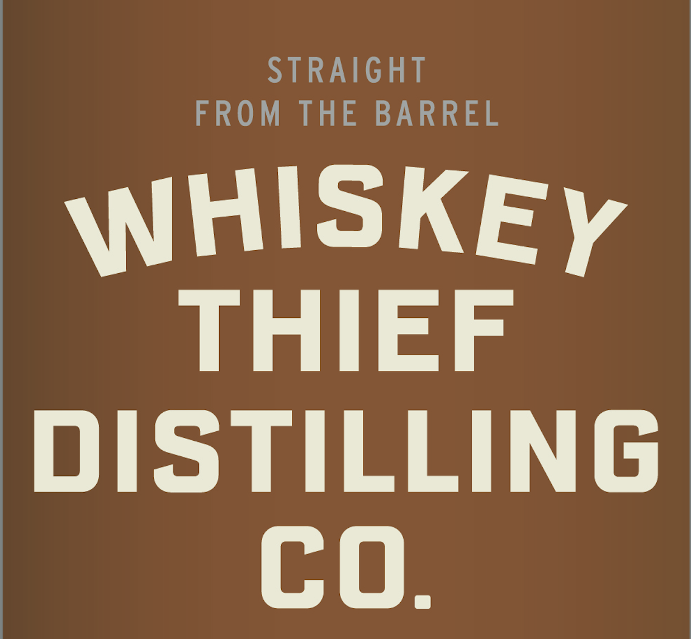
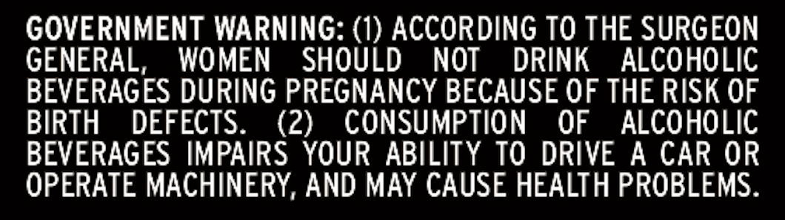

# TTB COLA Label Images - TTBID 26303001000135

**Brand Name:** WHISKEY THIEF DISTILLING CO.

**Fanciful Name:** STAY RAD

**Issue Date:** 11/03/2026

**Origin Code:** 22

**Product Class/Type:** 101

**Source:** [TTB Public COLA Registry](https://ttbonline.gov/colasonline/viewColaDetails.do?action=publicFormDisplay&ttbid=26303001000135)

## Label Images

### Front Label

### Label 1

### Label 3

### Label 4

## Extracted Label Text

*Text extracted via OCR - may contain errors*

*1 image(s) excluded: text did not meet readability threshold*

### Front Label

ALcIvoL
PROOF
INTERNET ONLY
AGE IN YEARS
BBL
BOTTLED
BY
WHISKEY THIEF DISTILLING CO
LiMITED RELEASE
FRANKFORT
KENTUCKY
502
IDD
YEATzs
11-F81
IN
FRANKLIN
COUNTY
MASHBILL
750ML
HAND FILLCD
SINGLEBARREL
4501PIYME
WHISKEY THICFCOM
Tkief
(uhiskey
0
#
Ofaxb
Ionus
1
8
bourbor
Straisht

### Label 1

STRAIGHT
FROM
THE
BARREL
WHISKEY
THIEF
DISTILLING
co.

### Label 3

GOVERNMENT WARNING: (1) ACCORDING TO THE SURGEON

GENERAL, WOMEN SHOULD NOT DRINK ALCOHOLIC

BEVERAGES DURING PREGNANCY BECAUSE OF THE RISK OF

BIRTH DEFECTS.

(2) CONSUMPTION OF ALCOHOLIC

BEVERAGES IMPAIRS YOUR ABILITY TO DRIVE A CAR OR

OPERATE MACHINERY, AND MAY CAUSE HEALTH PROBLEMS.
