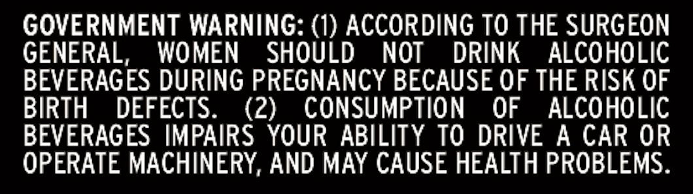

# TTB COLA Label Images - TTBID 26303001000136

**Brand Name:** WHISKEY THIEF DISTILLING CO.

**Fanciful Name:** METROPOLIS

**Issue Date:** 11/03/2026

**Origin Code:** 22

**Product Class/Type:** 101

**Source:** [TTB Public COLA Registry](https://ttbonline.gov/colasonline/viewColaDetails.do?action=publicFormDisplay&ttbid=26303001000136)

## Label Images

### Front Label

### Label 2

### Label 3

### Label 4

## Extracted Label Text

*Text extracted via OCR - may contain errors*

### Front Label

ALCIvL
PROoF
INTERNET ONLY
AGE IN YEARS
BBL
BOTTLED
BY
WHISKEY THIEF DISTILLING
THE MEDIATOR
LIMITED RELEASE
FRANKFORT
KENTUCKY
50%6
IDD
IN FRANKLIN
COUNTY
BETWEEN
TOMORROWwAS
HAND-FILLED
1
MASHBILL
750ML
@NDTTFFARDS
1
JUSTIADREAM
SINGLE BARREL
WHISKEVTHIEF.COM
MUST BE THE HEART.
300000000
Liooa
THIEF
WHiskEv
)
1
1
1
Bourbon
Straight
3aa o Ooodoo s

### Label 2

STRAIGHT
FROM
THE
BARREL
WHISKEY
THIEF
DISTILLING
co.

### Label 3

nm744460
Mi4
FIw
osFFRxww
THE
AXJALNJX
1
1
1
WHISKEY
S]ME1}

### Label 4

GOVERNMENT WARNING: (1) ACCORDING TO THE SURGEON

GENERAL, WOMEN SHOULD NOT DRINK ALCOHOLIC

BEVERAGES DURING PREGNANCY BECAUSE OF THE RISK OF

BIRTH DEFECTS.

(2) CONSUMPTION OF ALCOHOLIC

BEVERAGES IMPAIRS YOUR ABILITY TO DRIVE A CAR OR

OPERATE MACHINERY, AND MAY CAUSE HEALTH PROBLEMS.
