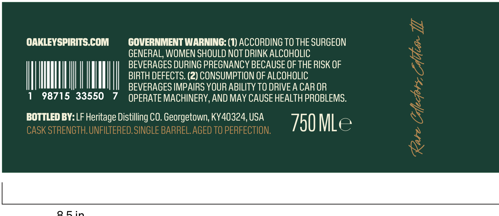
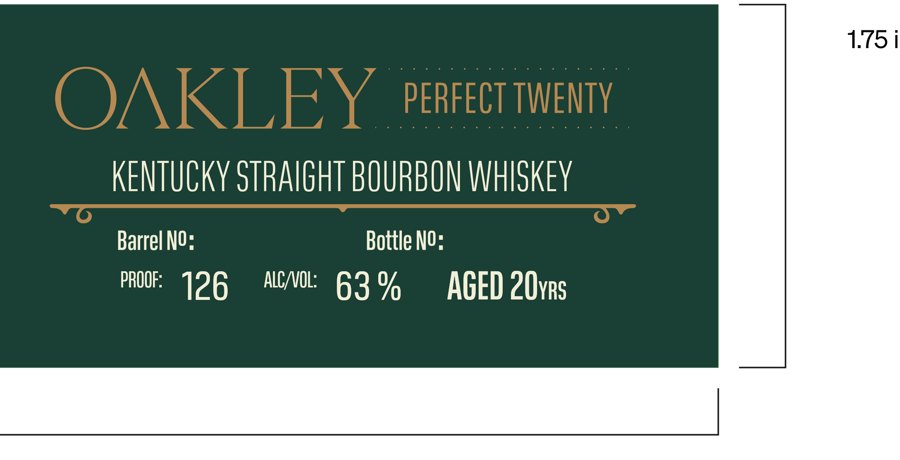

# TTB COLA Label Images - TTBID 26303001000140

**Brand Name:** OAKLEY

**Issue Date:** 11/16/2026

**Origin Code:** 22

**Product Class/Type:** 101

**Source:** [TTB Public COLA Registry](https://ttbonline.gov/colasonline/viewColaDetails.do?action=publicFormDisplay&ttbid=26303001000140)

## Label Images

### Back Label

### Front Label

### Label 3

## Extracted Label Text

*Text extracted via OCR - may contain errors*

*1 image(s) excluded: text did not meet readability threshold*

**Detected Age:** 20 Years

### Back Label

OAKLEYSPIRITS COM
GOVERNMENT WARNING: (7) ACCORDING TO THE SURGEON
GENERAL, WOMEN SHOULD NOT DRINK AlcohOLIc
BEVERAGES DURING PREGNANCY BECAUSE OF THE RISK OF
BIRTH DEFECTS: (2) CONSUMPTION OF ALCOHOLIC
1
BEVERAGES IMPAIRS YOUR ABILITY TO DRIVE A CAR OR
1
98715
33550
OPERATE MACHINERY,AND MAY CAUSE HEALTH PROBLEMS.
BOTTLED BY: LF Heritage Distilling CO. Georgetown; KY40324, USA
CASK STRENGTH. UNFILTERED. SINGLE BARREL. AGED TO PERFECTION:
750MLe
N
0 Din

### Front Label

KENTUCKY STRAIGHT BOURBON WHISKEY
Barrel NO; Bottle NO:
PaO 126 MM 63% AGED 20 yrs
