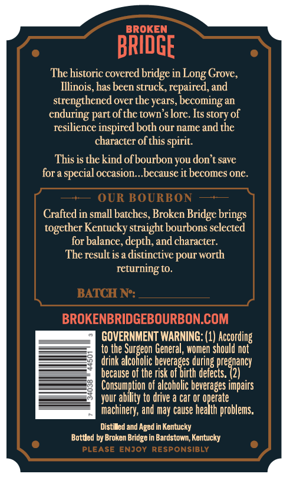
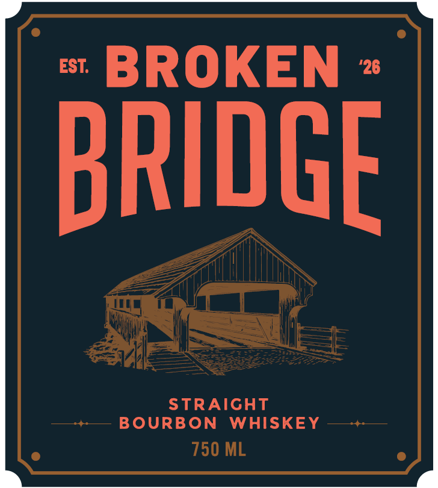
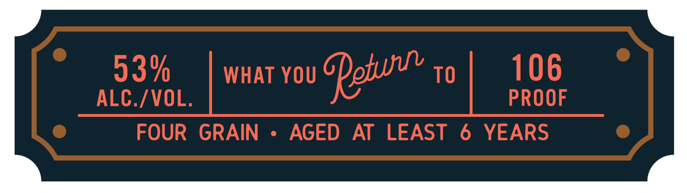

# TTB COLA Label Images - TTBID 26303001000144

**Brand Name:** BROKEN BRIDGE

**Issue Date:** 11/05/2026

**Origin Code:** 22

**Product Class/Type:** 101

**Source:** [TTB Public COLA Registry](https://ttbonline.gov/colasonline/viewColaDetails.do?action=publicFormDisplay&ttbid=26303001000144)

## Label Images

### Back Label

### Front Label

### Label 2

## Extracted Label Text

*Text extracted via OCR - may contain errors*

**Detected Proof:** 106
**Detected Age:** 6 Years

### Back Label

BROKEN
bRIDGE
The historic covercd bridge in
Grove;
Illinois, has been struck, repaired, and
strengthened over the years, becoming an
enduring part ofthe town s lore Its story of
resilience inspired both our name and the
character ofthis spirit:
This is thekind ofbourbonyou don t save
for a special occasion,because it becomes one.
OUR BOURBON
Crafted in small batches, Broken Bridge brings
together Kentucky straight bourbons selected
for balance, depth, and character.
The result is a distinctive pour worth
returning to.
BATCH Ne:
BROKENBRIDGEBOURBON.COM
GOVERNMENT WARNING: (1) According
to the -
General, women should not
drink
acanone Geean 5 UMon Showaaney
because of the risk of birth defects. (2)
Consumption of alcoholic beverages impairs
your ability to drive a Car or operate
machinery; and may cause health problems.
Distibed and Aged in Kentucky
Bottled by Broken
in Bardstown; Kentucky
PLEASE
ENJOY
RESPONSIbLy
Long
 Bridge

### Front Label

EST:
BROKEN
'26
brIDGE
STRAIGHT
BOURBON
WHISKEY
750 ML

### Label 2

53%
WHAT YOU
TO
106
ALC /VOL.
PROOF
FOUR
GRAIN
AGED
AT
LEAST
6
YEARS
Fetun
