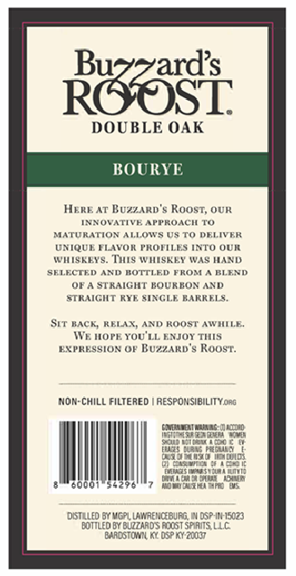
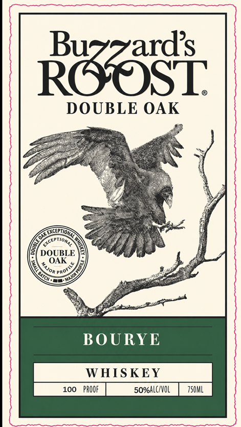

# TTB COLA Label Images - TTBID 26303001000158

**Brand Name:** BUZZARD'S ROOST

**Issue Date:** 11/06/2026

**Origin Code:** 22

**Product Class/Type:** 140

**Source:** [TTB Public COLA Registry](https://ttbonline.gov/colasonline/viewColaDetails.do?action=publicFormDisplay&ttbid=26303001000158)

## Label Images

### Back Label

### Label 1

## Extracted Label Text

*Text extracted via OCR - may contain errors*

**Detected Proof:** 100

### Back Label

ROOST

DOUBLE OAK

BOURY

Here ar Buzzarp’s Roost, OUR

INNOWATIVE al

PROACH TO

MATURATION ALLOWS US.TO DELIVER

UNIQUE FLAVOR PROFILES INTO OUR

WHISKEY, TIS WHISKEY WAS HAND

SELECTED AND

JOTFLED FROM A BLEND

OF A STRAIGHT BOURBON AND

STRAIGHT RYE SINGLE BARKELS.

SUT BACK, RELAX, AND ROOST AWHILE

We nore You

ENJOY THIS

pXPRESSION oF Buzzanv's Roost

[NON-CHILL FILTERED | RESPONSIBILITY.200

‘oman manag 31:20

fa

on

ie ft

fia

ca Past

Seta pee

a

‘stew gt

a

(sce vam

ih

Perea

e000 ssevel 7 kawaii os

osm

WGP LANRENCEBURG.

SP S02

BOTTLED SY BUZZARD ADST SPS, LLC

ARDSTOM Ki O52 KE Z0037

### Label 1

Raasi
DOUBLE OAK
EXCEPTIo;
DOUBLE
OAK
BOURYE
WHIS KEY
100
PROOF
so%HLC/VOL
750ML
EXCEP)
TOnA
Profile
MJor =
