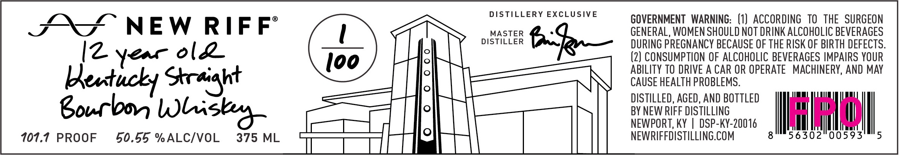

# TTB COLA Label Images - TTBID 26303001000190

**Brand Name:** NEW RIFF

**Issue Date:** 11/04/2026

**Origin Code:** 22

**Product Class/Type:** 101

**Source:** [TTB Public COLA Registry](https://ttbonline.gov/colasonline/viewColaDetails.do?action=publicFormDisplay&ttbid=26303001000190)

## Label Images

### Front Label

## Extracted Label Text

*Text extracted via OCR - may contain errors*

**Detected Proof:** 101.1

### Front Label

DISTILLERY EXCLUSIVE
GOVERNMENT   WARNING: (1) ACCORdINg  to   thE   SURGEON
NEW
RIFF
MASTER
GENERAL, WOMEN SHOULD NOT DRINK ALCOHOLIC BEVERAGES
DISTILLER
6k
DURING PREGNANCY BECAUSE OF THE RISK OF BIRTH DEFECTS:
6l2
(2) CONSUMPTION OF ALCOHOLC BEVERAGES IMPAIRS YOUR
Ioo
ABILITY TO DRIVE A CAR OR OPERATE
MACHINERY, AND MAY
Lkentucky Straight
CAUSE HEALTH PROBLEMS:
DISTILLED, AGED, AND BOTTLEd
goucbo
BY NEW RIFF DISTILLING
Hsu
NEWPORT, KY
DSP-KY-20016
101.1
PROOF
50.55 %ALCIVOL
375 ML
NEWRIFFDISTILLING.COM
8
56302"00593
5
I2
Yer
Wliigbr
