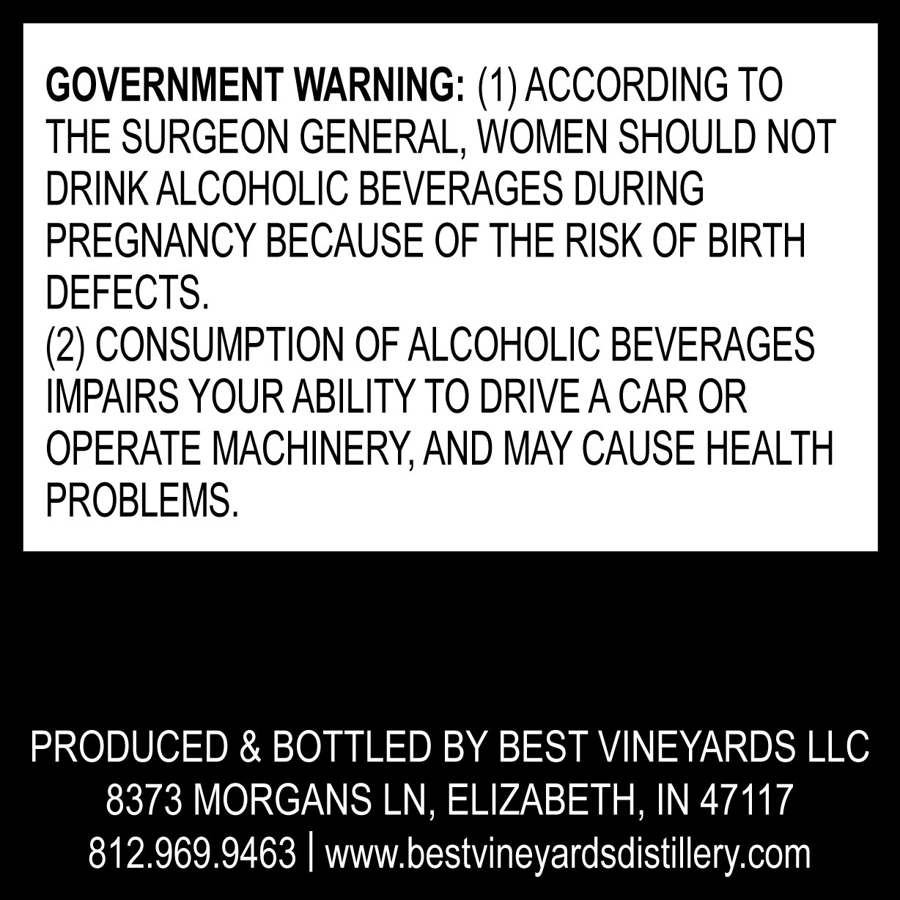
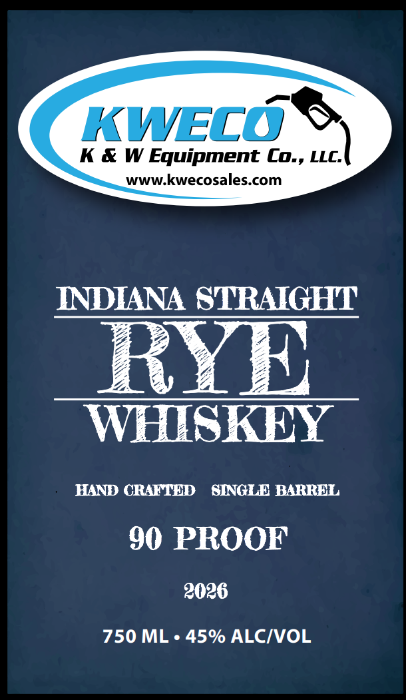

# TTB COLA Label Images - TTBID 26303001000193

**Brand Name:** KWECO

**Issue Date:** 11/04/2026

**Origin Code:** 19

**Product Class/Type:** 102

**Source:** [TTB Public COLA Registry](https://ttbonline.gov/colasonline/viewColaDetails.do?action=publicFormDisplay&ttbid=26303001000193)

## Label Images

### Back Label

### Label 1

## Extracted Label Text

*Text extracted via OCR - may contain errors*

**Detected Proof:** 90

### Back Label

GOVERNMENT WARNING: (1) ACCORDING TO
THE SURGEON GENERAL, WOMEN SHOULD NOT
DRINK ALCOHOLIC BEVERAGES DURING
PREGNANCY BECAUSE OF THE RISK OF BIRTH
DEFECTS.
(2) CONSUMPTION OF ALCOHOLIC BEVERAGES
IMPAIRS YOUR ABILITY TO DRIVEACAR OR
OPERATE MACHINERY,AND MAY CAUSE HEALTH
PROBLEMS .
PRODUCED & BOTTLED BY BEST VINEYARDS LLC
8373 MORGANS LN, ELIZABETH, IN 47117
812.969.9463
wwwbestvineyardsdistillery com

### Label 1

KWVECO
K & W Equipment Coz, LLC;
WWW.kwecosales com
INDIANA STRAIGHT
RYI
WHISKEY
HAND CRAFTED
SINGLE BARREL
90 PROOF
2026
750 ML . 45% ALCIVOL
