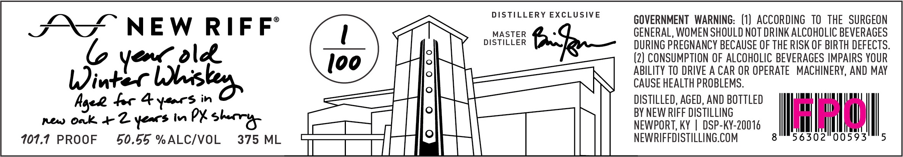

# TTB COLA Label Images - TTBID 26303001000195

**Brand Name:** NEW RIFF

**Issue Date:** 11/04/2026

**Origin Code:** 22

**Product Class/Type:** 140

**Source:** [TTB Public COLA Registry](https://ttbonline.gov/colasonline/viewColaDetails.do?action=publicFormDisplay&ttbid=26303001000195)

## Label Images

### Front Label

## Extracted Label Text

*Text extracted via OCR - may contain errors*

**Detected Proof:** 107.7

### Front Label

SS NEW RIFF’

yooum old

Winter Wis
Ager fer 4 ysors in
new oak + Z years in PX sherry

107.7 PROOF

50.55 %ALC/VOL

375 ML

DISTILLERY EXCLUSIVE

M“e—

MASTER
DISTILLER

GOVERNMENT WARNING: (1) ACCORDING TO THE SURGEON
GENERAL, WOMEN SHOULD NOT DRINK ALCOHOLIC BEVERAGES
DURING PREGNANCY BECAUSE OF THE RISK OF BIRTH DEFECTS.
(2) CONSUMPTION OF ALCOHOLIC BEVERAGES IMPAIRS YOUR
ABILITY TO DRIVE A CAR OR OPERATE MACHINERY, AND MAY
CAUSE HEALTH PROBLEMS.

DISTILLED, AGED, AND BOTTLED
BY NEW RIFF DISTILLING
NEWPORT, KY | DSP-KY-20016

NEWRIFFDISTILLING.COM gn 56302 00593" 5
