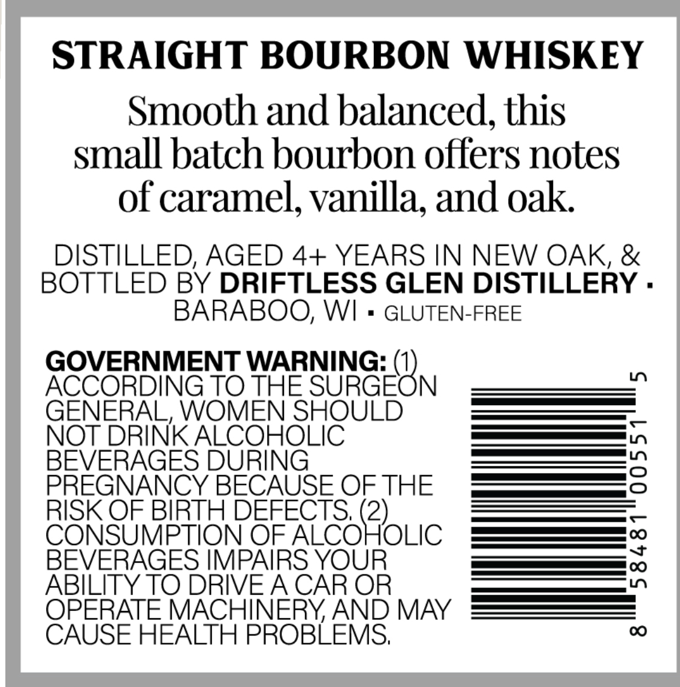
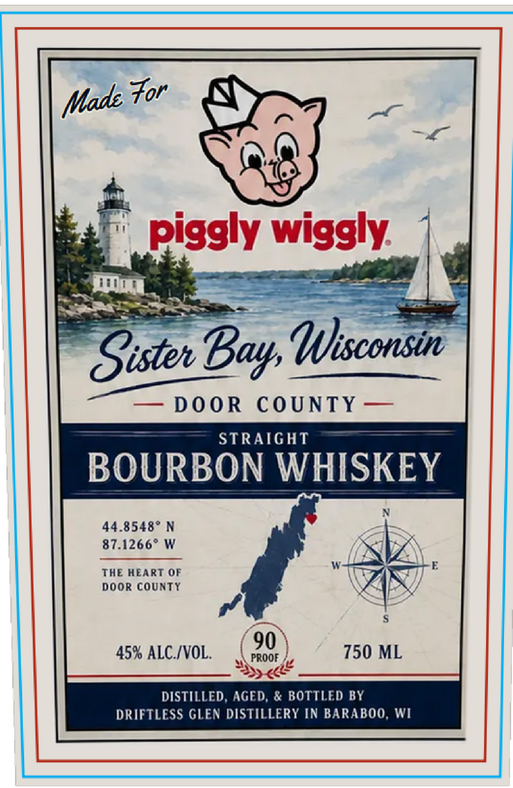

# TTB COLA Label Images - TTBID 26303001000229

**Brand Name:** PIGGLY WIGGLY

**Issue Date:** 11/06/2026

**Origin Code:** 48

**Product Class/Type:** 101

**Source:** [TTB Public COLA Registry](https://ttbonline.gov/colasonline/viewColaDetails.do?action=publicFormDisplay&ttbid=26303001000229)

## Label Images

### Back Label

### Front Label

## Extracted Label Text

*Text extracted via OCR - may contain errors*

**Detected Proof:** 90

### Back Label

STRAIGHT BOURBON WHISKEY
Smooth and balanced, this
small batch bourbon offers notes
of caramel; vanilla; and oak
DISTILLED; AGED 4+ YEARS IN NEW OAK, &
BOTTLED BY DRIFTLESS GLEN DISTILLERY .
BARABOO; WI
GLUTEN-FREE
GOVERNMENT WARNING:
1
ACCORDING TO THE SURGEON
GENERAL, WOMEN SHOULD
NOT DRINK ALCOHOLIC
BEVERAGES DURING
3
PREGNANCY BECAUSE OF THE
RISK OF BIRTH DEFECTS, (2)
CONSUMPTION OF ALCOHOLIC
BEVERAGES IMPAIRS YOUR
1
ABILITY TO DRIVEA CAR OR
OPERATE MACHINERYAND MAY
CAUSE HEALTH PROBLEMS;
00

### Front Label

For
piggly wiggly
Sisten
WJisconsin
DoOR
CoUNTY
STRAIGHT
BOURBON WHISKEY
44.8548" N
87.1266* W
THE HEART QF
door county
5
90
45% ALC /VOL.
PROOF
750 ML
DISTILLED, AGED; & BOTTLED BY
DRIFTLESS GLEN DISTILLERY IN BARABOO, WI
Made
Bay
