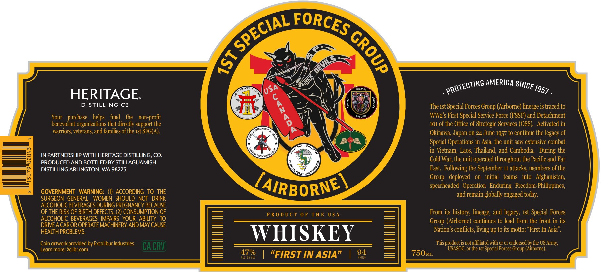

# TTB COLA Label Images - TTBID 26303001000249

**Brand Name:** 1ST SPECIAL FORCES GROUP

**Issue Date:** 11/04/2026

**Origin Code:** 07

**Product Class/Type:** 140

**Source:** [TTB Public COLA Registry](https://ttbonline.gov/colasonline/viewColaDetails.do?action=publicFormDisplay&ttbid=26303001000249)

## Label Images

### Label 1

## Extracted Label Text

*Text extracted via OCR - may contain errors*

**Detected Proof:** 94

### Label 1

AMERICA
HERITAGE
DISTILLING cg
#
2
The Ist Special Forces Group (Airborne) lineage is traced to
Your   purchase
helps
fund
the   non-profit
757637
WW2 s First Special Service Force (FSSF) and Detachment
benevolent organizations that directly support the
101 of the Office of Strategic Services (OSS). Activated in
warriors; veterans,and families of the Ist SFG(A):
A
Okinawa; Japan on 24 June 1957 to continue the legacy of
Special Operations in Asia; the unit saw extensive combat
in Vietnam; Laos, Thailand , and Cambodia
During the
IN PARTNERSHIP WITH HERITAGE DISTILLING, CO_
Ia"
PRODUCED AND BOTTLED BY STILLAGUAMISH
Cold War; the unit operated throughout the Pacific and Far
DISTILLING ARLINGTON, WA 98223
East: Following the September 11 attacks, members of the
VORcES Grole
Group   deployed
on
initial   teams   into   Afghanistan;
[airbornet
spearheaded   Operation   Enduring   Freedom-Philippines;
GOVERNMENT WARNING:
ACCORDING TO THE
and remain globally engaged today.
SURGEON   GENERAL,
WOMEN  SHOULD NOT  DRINK
ALCOHOLIC BEVERAGES DURING PREGNANCY BECAUSE
OF THE RISK OF BIRTH DEFECTS, (2) CONSUMPTION OF
PRO DUCT 0F THE US A
From its history; lineage, and legacy; Ist Special Forces
ALCOHOLIC BEVERAGES IMPAIRS  YOUR ABILITY TO
(Airborne) continues to lead from the front in its
DRIVEA CAR OR OPERATE MACHINERYAND MAY CAUSE
HEALTH PROBLEMS.
WHISKEY
Nation $ conflicts; living up to its motto: "First In Asia"
Coin artwork provided by Excalibur Industries
This product is not affiliated with or or endorsed by the US Army;
Learn more: Xclibr com
(CA CRUJ
USASOC; or the Ist Special Forces Group (Airborne).
47%
"FIRST IN ASIA"
94
750ML
FORCES
SPECIAL _
8
5
PROTECTING ,
SINCE
1957 -
(USA
6
ccqua
1
Group
