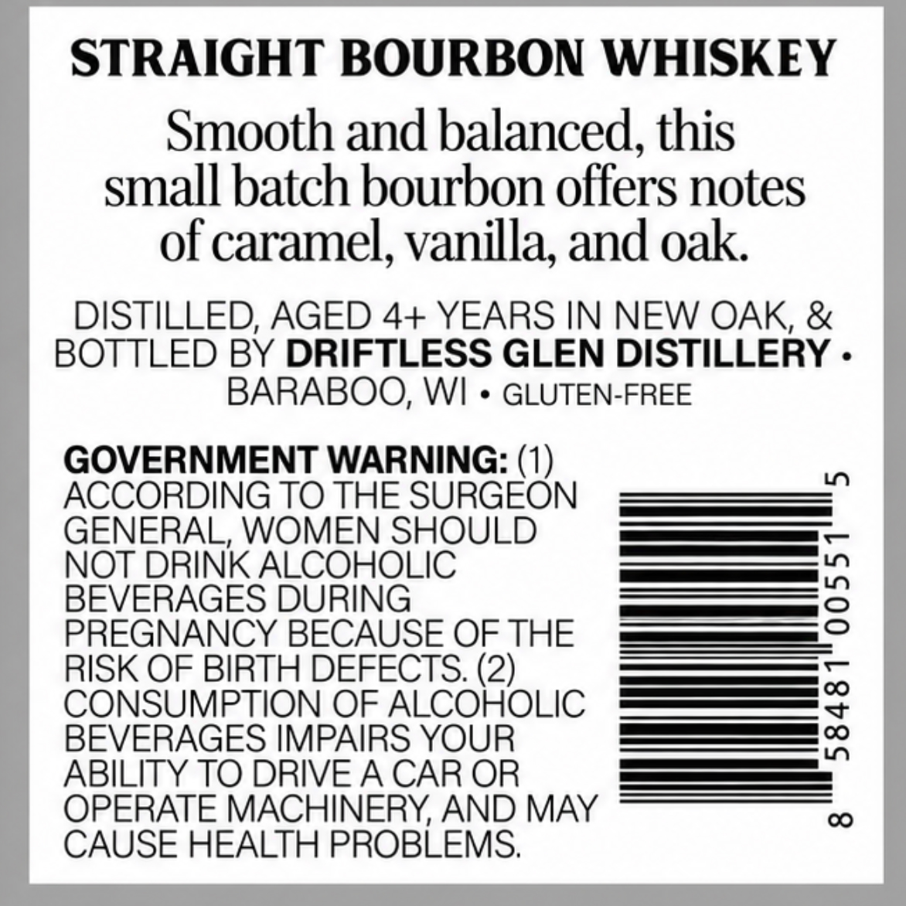
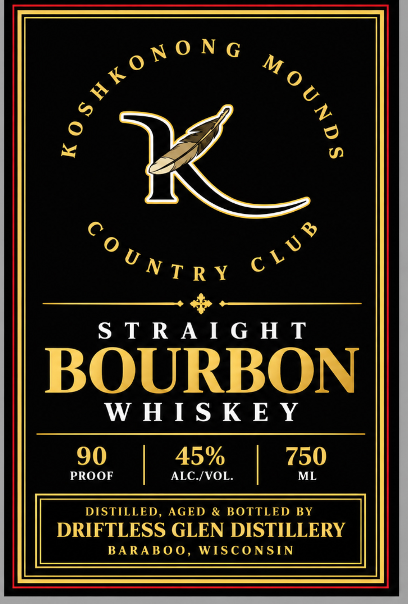

# TTB COLA Label Images - TTBID 26303001000252

**Brand Name:** KOSHKONONG MOUNDS COUNTRY CLUB

**Issue Date:** 11/04/2026

**Origin Code:** 48

**Product Class/Type:** 101

**Source:** [TTB Public COLA Registry](https://ttbonline.gov/colasonline/viewColaDetails.do?action=publicFormDisplay&ttbid=26303001000252)

## Label Images

### Back Label

### Front Label

## Extracted Label Text

*Text extracted via OCR - may contain errors*

**Detected Proof:** 90

### Back Label

STRAIGHT BOURBON WHISKEY
Smooth and balanced,
9
this
small batch bourbon offers notes
of caramel,
9
vanilla; and oak
DISTILLED, AGED 4+ YEARS IN NEW OAK, &
BOTTLED BY DRIFTLESS GLEN DISTILLERY .
BARABOO, WI
GLUTEN-FREE
GOVERNMENT WARNING: (1)
LO
ACCORDING TO THE SURGEON
GENERAL, WOMEN SHOULD
NOT DRINK ALCOHOLIC
BEVERAGES DURING
3
PREGNANCY BECAUSE OF THE
RISK OF BIRTH DEFECTS: (2)
CONSUMPTION OF ALCOHOLIC
3
BEVERAGES IMPAIRS YOUR
ABILITY TO DRIVE A CAR OR
OPERATE MACHINERY, AND MAY
00
CAUSE HEALTH PROBLEMS;

### Front Label

gtONe

O

Ny)

“NTRy ©

zm

STRAIGHT

BOURBON

WHISKEY

90

45%

PROOF

|

ALC./VOL.

| 730

DISTILLED, AGED & BOTTLED BY

DRIFTLESS GLEN DISTILLERY

BARABOO, WISCONSIN
