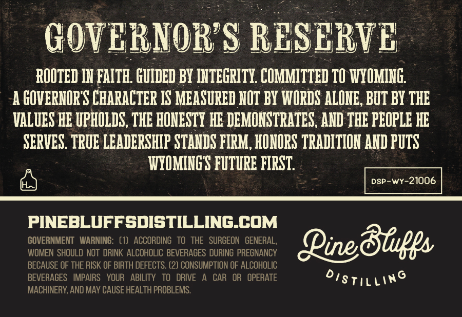
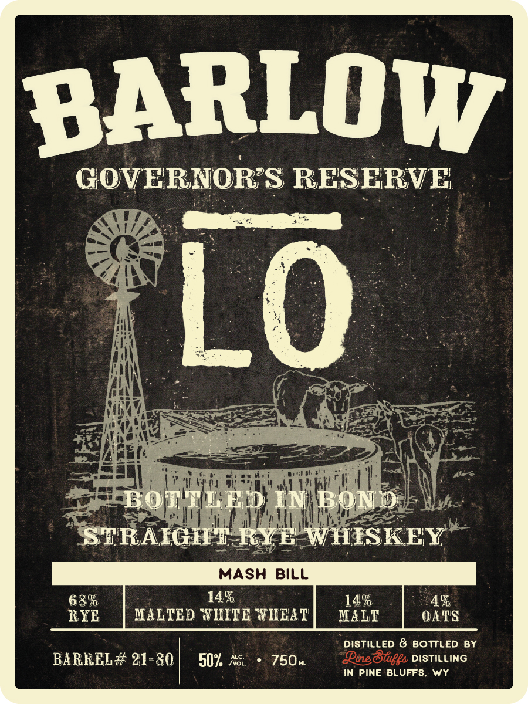

# TTB COLA Label Images - TTBID 26303001000266

**Brand Name:** PINE BLUFFS DISTILLING

**Fanciful Name:** BARLOW GOVERNOR'S RESERVE BOTTLED IN BOND

**Issue Date:** 11/12/2026

**Origin Code:** 49

**Product Class/Type:** 112

**Source:** [TTB Public COLA Registry](https://ttbonline.gov/colasonline/viewColaDetails.do?action=publicFormDisplay&ttbid=26303001000266)

## Label Images

### Back Label

### Front Label

### Label 3

## Extracted Label Text

*Text extracted via OCR - may contain errors*

*1 image(s) excluded: text did not meet readability threshold*

**Detected Proof:** 126

### Back Label

GOVBRNORS RESERVE
ROOTED IN FAITH  GUIDED BY INTEGRITY. COMMITTED TO WVYOMING
A
GOVERNOR S CHARACTER IS MEASURED NOT BY WORDS ALONE, BuT BY THE
VALUES HE UPHOLDS , THE HONESTY HE DEMONSTRATES, AND THE PEOPLE HE
SERVES. TRUE LEADERSHIP STANDS FIRM, HONORS TRADITION AND PuTS
WYOMING $ FUTURE FIRST:
DSP
wy-21006
PINEBLUFFsdISTILLING_COM
GOVERNMENT   WARNING:   (1)   ACCORDING   TO THE   SURGEON   GENERAL,
QineBuiuges
WOMEN SHOULD NOT  DRINK ALCOHOLIC BEVERAGES DURING PREGNANCY
BECAUSE OF THE RISK OF BIRTH DEFECTS. (2) CONSUMPTION OF ALCOHOLIC
BEVERAGES   IMPAIRS   YOUR   ABILITY   TO   DRIVE
A CAR  OR   OPERATE
DisTI[[iNG
MACHINERY, AND MAY CAUSE HEALTH PROBLEMS.

### Front Label

BARLOW
GOVERNORS RESERVE
LO
Bof iEi ENIBOND
STRAIGH" RYE WHISKEY
MASH
BILL
63%
14%
14%
4%
RYE
MALTED WHITE "HEA T
MALT
0A TS
DISTILLEd & BOTTLED BY
BAREEL# 21-30
50% wo
750m
Pie86fgs DISTILLING
IN PINE BLUFFS.
WY
