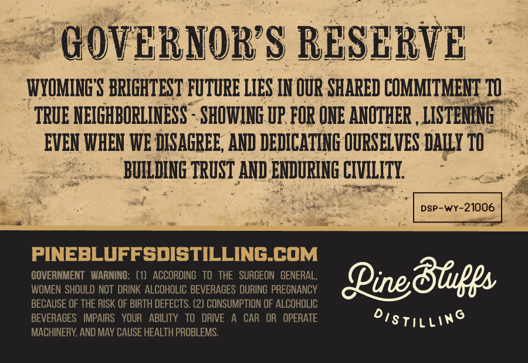
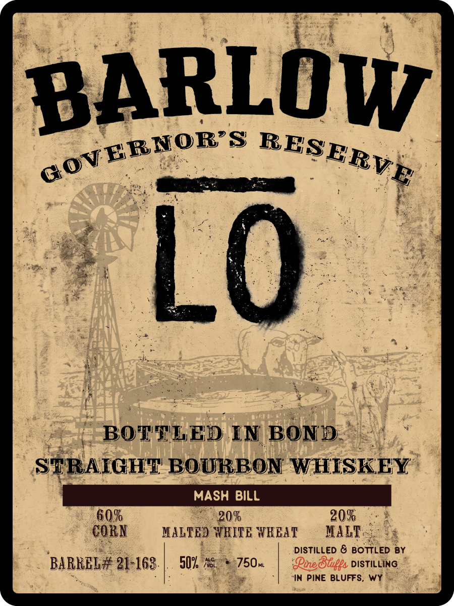

# TTB COLA Label Images - TTBID 26303001000268

**Brand Name:** PINE BLUFFS DISTILLING

**Fanciful Name:** BARLOW GOVERNOR'S RESERVE BOTTLED IN BOND

**Issue Date:** 11/05/2026

**Origin Code:** 49

**Product Class/Type:** 110

**Source:** [TTB Public COLA Registry](https://ttbonline.gov/colasonline/viewColaDetails.do?action=publicFormDisplay&ttbid=26303001000268)

## Label Images

### Back Label

### Front Label

### Label 3

## Extracted Label Text

*Text extracted via OCR - may contain errors*

*1 image(s) excluded: text did not meet readability threshold*

**Detected Proof:** 120

### Back Label

GOVERNORS RESERVE
WYOMINGS BRIGHTEST FUTURE LIES IN OUR SHARED COMMITMENT 10
TRUE NEIGHBORLINESS   SHOWING UP FOR ONE ANOTHER , LISTEMENG
EVEN WHEN WE DISAGREE; AND DEDICATING OURSELVES DAILY TO
BUILDING TRUST AND ENDURING CIVILITI
DSP-wY-21006
PINEBLUFFSDISTILLING_COM
GOVERNMENT   WARNING:   (1)   ACCORDING   To  THE   SURGEON   GENERAL,
@inedfiges
WOMEN SHOULD noT  DRINK ALCOHOLIC BEVERAGES DURING PREGNANCY
BECAUSE OF THE RISK OF BIRTH DEFECTS. (2) CONSUMPTION OF ALCOHOLIC
BEVERAGES   IMPAIRS   YOUR   ABILITY   TO   DRIVE
CAR   OR   OPERATE
Disti[ling
MACHINERY; AND MAY CAUSE HEALTH PROBLEMS.

### Front Label

BARLOW
Lo
BOTTLED IN BOND
SERAIGHT BOURBON WHISKEY
MASH BiLL
60%
20%
20%
COBN
XALTED WHITE WKELT
IALT
DISTilLED & BOTTLED BY
BABREL# 21-163.
50% No
750AL
Pie8upps DISTILLING
~IN Pine BLUFFS.
WY
GOVERNOR S
RESERVE
