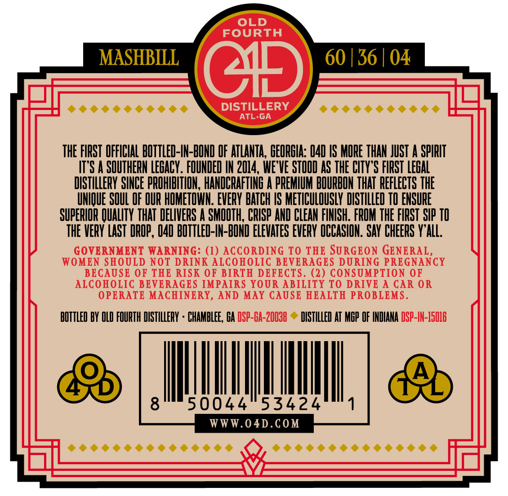
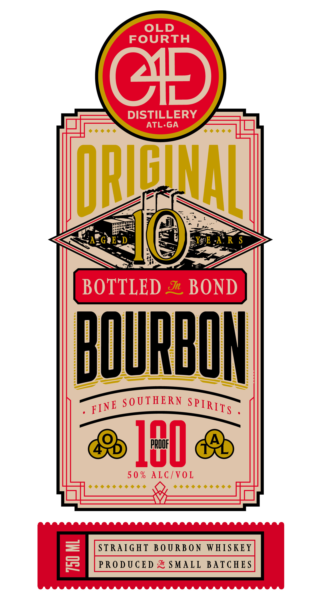
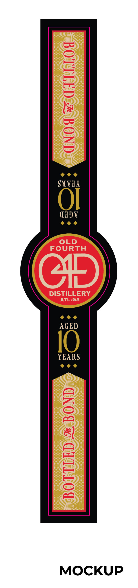

# TTB COLA Label Images - TTBID 26303001000278

**Brand Name:** OLD 4TH DISTILLERY

**Fanciful Name:** 10-YEAR BOTTLED-IN-BOND BOURBON

**Issue Date:** 11/12/2026

**Origin Code:** 08

**Product Class/Type:** 111

**Source:** [TTB Public COLA Registry](https://ttbonline.gov/colasonline/viewColaDetails.do?action=publicFormDisplay&ttbid=26303001000278)

## Label Images

### Back Label

### Front Label

### Label 2

## Extracted Label Text

*Text extracted via OCR - may contain errors*

**Detected Proof:** 100

### Back Label

OLD
FOURTH
MASHBILL
60 | 36 | 04
GID
DISTILLERY
ATL.GA
ThE FIRST OFFICHAL BOTTLED-IN-BOND OF ATLanta , GEORGIA: Q4D IS More THAN JUST A SPIRIT
IT"S A SOUTHERN LEBACY . FQUNDED IN 2014, we'Ve STOOD AS THE CITY"S FIRST Lebal
DISTILLERY SINCE PROHIBITION;, HANDCRAFTING A PREMIUM BOURBON THAT  ReFLECTS the
UNIQUE SOUL OF QUR HOMETOWN . EVERY BATCH IS METICULOUSLY DISTILLED TO ENSURE
SUPERIOR QuALITY THAT DELIVERS A SMOOTH, CRISP AND CLEAN FINISH . FROM the FIRST SHP TU
THE VERY LAST DROP , 040 BOTTLED-IN-BOND ELEVATES EVERY OCCASHON . SAV CHEERS V"ALL:
GOVERNMENT WARNING: (1) ACCORDING To THE SURGEON GENERAL,
WOMEN SHOULD NOT DRINK ALCOHOLIC BEVERAGES DURING PREGNANCY
BECAUSE OF THE RISK OF BIRTH DEFECTS. (2) CONSUMPTION OF
ALCOHOLIC BEVERAGES IMPAIRS YOUR ABILITY TO DRIVE A CAR OR
OPERATE MACHINERY, AND MAY GAUSE HEALTH PROBLEMS .
bOTTLED BY OLD FquRTH DISTILLERY " CHAMBLEE, BA DSP-Ga-ZQ038
DISTILLED AT Mep OF INDIANA DSP-IN-I5oie
8
50044
53424
WWW.04d.CoM

### Front Label

OLD

FOURTH

DISTILLERY

|

ATL-GA

1

A

a

————)

eure

ATGE=D”

=

pen ‘ R RS.

=<

eo

ry)

oe

a

fi

BOTTLED J BOND

BOURBON

INE a OUTHERN sp SPIRITS

® Hil Ad

50% ALC/VOL

ial

la

\Y?

=

S

TRAIGHT BOURBON WHISKEY

Loo

PRODUCED 2 SMALL BATCHE

S

—

### Label 2

ooo

SUVAA

CHV

eee

eee

AGED

YEARS

eee

MOCKUP
