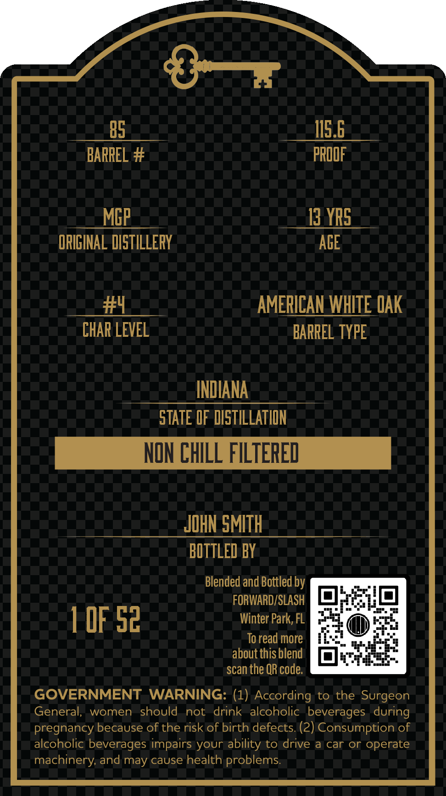
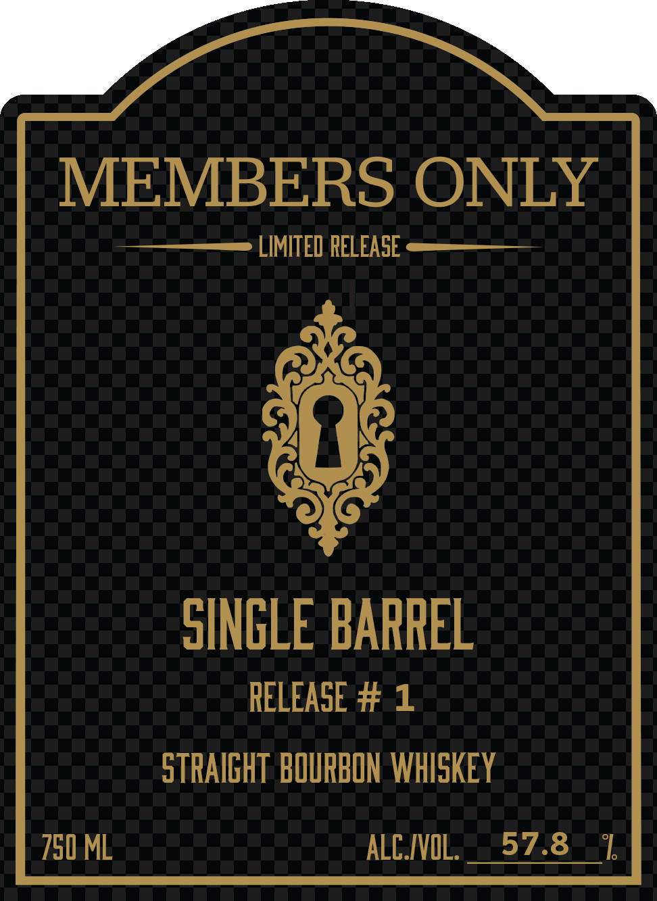

# TTB COLA Label Images - TTBID 26303001000280

**Brand Name:** MEMBERS ONLY

**Issue Date:** 10/30/2026

**Origin Code:** 16

**Product Class/Type:** 101

**Source:** [TTB Public COLA Registry](https://ttbonline.gov/colasonline/viewColaDetails.do?action=publicFormDisplay&ttbid=26303001000280)

## Label Images

### Back Label

### Front Label

### Label 2

## Extracted Label Text

*Text extracted via OCR - may contain errors*

*1 image(s) excluded: text did not meet readability threshold*

**Detected Age:** 13 Years

### Back Label

85
J15.6
BARREL #
PROOF
MGP
13 YRS
ORIGINAL DISTILLERY
ACE
#4
AMERICAN WHITE OAK
CHAP LEVEL
BARREL TYPE
INDIANA
STATE OF DISTILLATION
NON ChILL FILTERED
JOHN SMITH
BOTTLED BY
Blended and Bottled by
FORWARD/SLASH
1 OF 52
Winter Park, FL
To read more
about this blend
scan the QR code.
GOVERNMENT
WARNING: (1) According to the Surgeon
General;
women
should
not
drink alcoholic beverages   during
pregnancy because of the risk of birth defects (2) Consumption of
alcoholic beverages impairs your ability to drive
car or operate
machinery; and may cause health problems

### Front Label

MEMBERS ONLY
LIMITED RELEASE
SINGLE BARREL
RELEASE #
1
STRAIGHT  BOURBON WHISKEY
750 ML
ALCIVOL:
57.8
