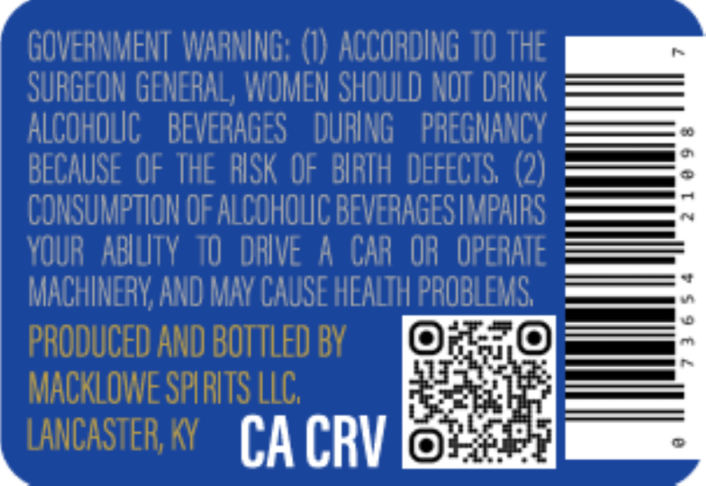
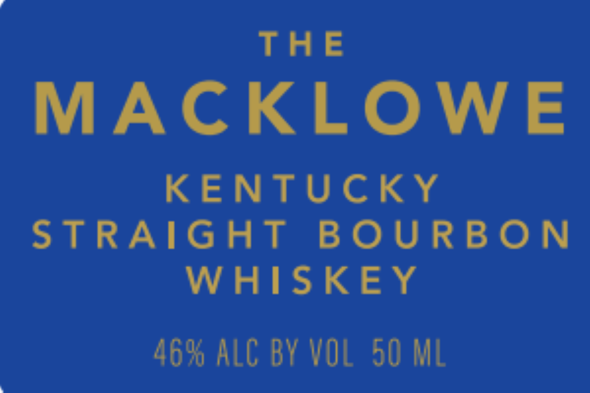

# TTB COLA Label Images - TTBID 26303001000324

**Brand Name:** MACKLOWE

**Issue Date:** 11/09/2026

**Origin Code:** 22

**Product Class/Type:** 101

**Source:** [TTB Public COLA Registry](https://ttbonline.gov/colasonline/viewColaDetails.do?action=publicFormDisplay&ttbid=26303001000324)

## Label Images

### Back Label

### Front Label

## Extracted Label Text

*Text extracted via OCR - may contain errors*

**Detected Proof:** 92

### Back Label

GOVERNMENT  WARNING; (I) ACCOROING TO the
SURGEON GENERAL, WOMEN SHOULD NOT DRINK
ALCOHOLC
BEVERAGES
DURING
PREGMANCY
EU
m
BECAUSE OF THE RISK OF BIRTH  DEFECTS; (2)
2
CONSUMPTLON OF ALCOHOLC BEVERAGES IMPAIPS
~
YOUR   ABIUTY  10  daive A CAR OR  OPERAIE
MACHINERY AND MaY CAUSE HEALTH PROBLEMS;
4
0
PRODUCED AND BOTTled BY
m
MACKLOWE SPLRITS LLC;
LANCASTER; KY
CA CRV

### Front Label

THE

MACKLOWE

KENTUCKY

STRAIGHT BOURBON

WHISKEY

46% ALC BY VOL 50 ML
