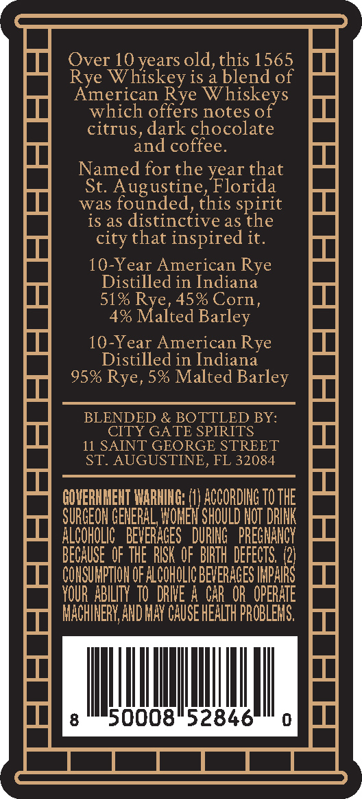
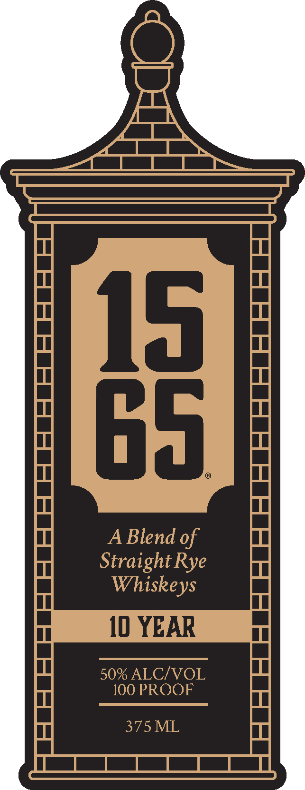

# TTB COLA Label Images - TTBID 26303001000350

**Brand Name:** 1565

**Issue Date:** 11/10/2026

**Origin Code:** 16

**Product Class/Type:** 122

**Source:** [TTB Public COLA Registry](https://ttbonline.gov/colasonline/viewColaDetails.do?action=publicFormDisplay&ttbid=26303001000350)

## Label Images

### Back Label

### Front Label

### Label 3

## Extracted Label Text

*Text extracted via OCR - may contain errors*

*1 image(s) excluded: text did not meet readability threshold*

**Detected Proof:** 102
**Detected Age:** 10 Years

### Back Label

Over 10 years old,this 1565
Rye Whiskey is a blend of
American
Whiskeys
which offers notes of
citrus, dark chocolate
and coffee_
Named for the year that
St: Augustine,Florida
was founded,this spirit
is aS distinctiveas the
that inspired it.
10-Year American Rye
Distilled in Indiana
51%
45% Corn ,
4% Malted Barley
10-Year American Rye
Distilled in Indiana
95% Rye, 5% Malted Barley
BLENDED & BOTTLED BY:
CITY GATE SPIRITS
11 SAINT GEORGE STREET
ST. AUGUSTINE, FL 32084
GOHERHMEHT WARHIHG: (1) ACCORDING TO THE
SURGEOH GENERAL, WOMEN SHOULD Not DRINK
ALCOHOLIC   BEVERAGES  DURING   PREGHANGY
BECAUSE  OF THE  RISK OF  BIRTH DEFECTS: /2)
COHSUMPTHOH OF ALCOHOLIC BEVERAGES IMPAIRS
YOUR ABILITY  tO   drIE A CAR OR  OPERATE
MACHINERY,AND May Cause HEaLTh PROBLEMS:,
50008"52846
Rye
city
Rye

### Front Label

85
A Blend of
StraightRye
Whiskeys
10 YEAR
50% ALCIVOL
100 PROOF
375 ML
