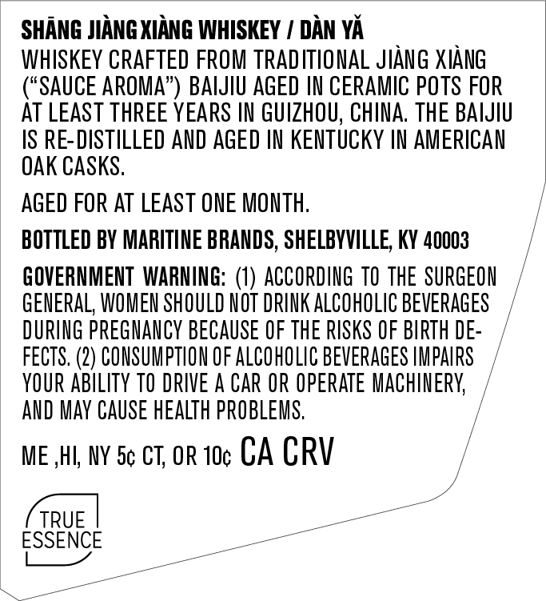
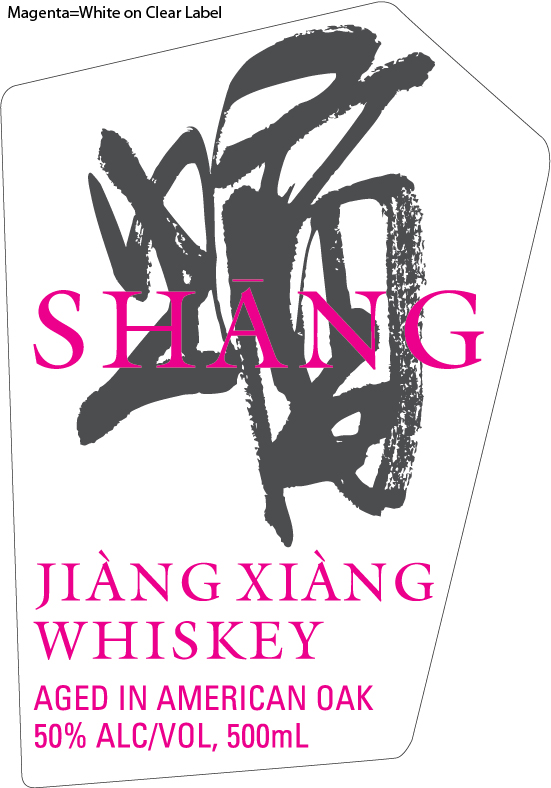

# TTB COLA Label Images - TTBID 26303001000409

**Brand Name:** SHANG

**Fanciful Name:** EAST + WEST

**Issue Date:** 11/04/2026

**Origin Code:** 22

**Product Class/Type:** 140

**Source:** [TTB Public COLA Registry](https://ttbonline.gov/colasonline/viewColaDetails.do?action=publicFormDisplay&ttbid=26303001000409)

## Label Images

### Back Label

### Front Label

### Label 2

## Extracted Label Text

*Text extracted via OCR - may contain errors*

*1 image(s) excluded: text did not meet readability threshold*

**Detected Proof:** 100

### Back Label

SHANG JIANG XIANG WHISKEY
DAN YA
WHISKEY CRAFTED FROM TRAD ITIONAL JIANG XIANG
SAUCE AROMA'
BAIJIU AGED IN CERAMIC POTS FOR
AT LEAST THREE YEARS IN GUIZHOU; CHINA  THE BAIJIU
IS RE-DISTILLED AND AGED IN KETuCKY IN AMERICAN
OAK CASKS,
AGED FOR AT LEAST ONE MOnth;
BOTTLed BY MARITINE BRANDS, SHELBVVILLE; KY 40003
GOVERNMENT  WARNING: (1) ACCORDING TO the SURGEON
GENERAL, WOMEN SHOULD HOT DRINK ALCOHOLIC BEVERAGES
DURING pREGNANCY BECAUSE €F THE RISKS OF BIRTH DE:
FECTS. (2) CONSUMPTION OF ALCOHOLIC BEVERaGeS HMPAIRS
YOUR ABIlITy TO DRIVE A CAR OR Operate MAChINERK;
AND May CAUSe heAlTh PROBLEMS.
ME,HI; NY 5c CT; OR 1Oc CA CRV
TRUE
ESSENCE

### Front Label

Magenta-White on Clear Label
SH #1G
JIANG XIANG
WHISKEY
AGED IN AMERICAN OAK
50% ALCIVOL, 5OOmL
