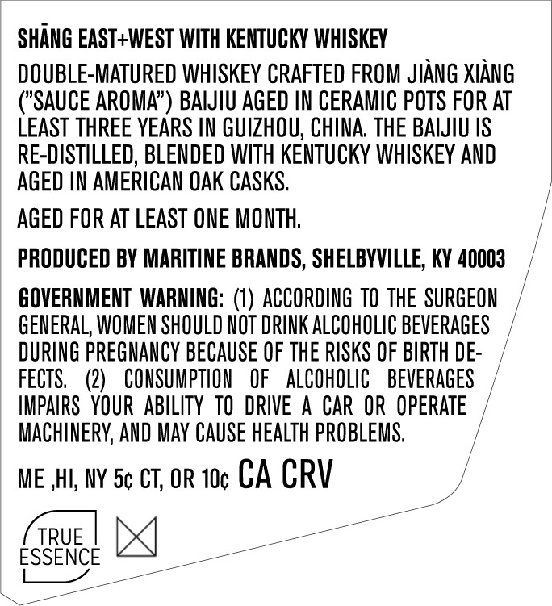
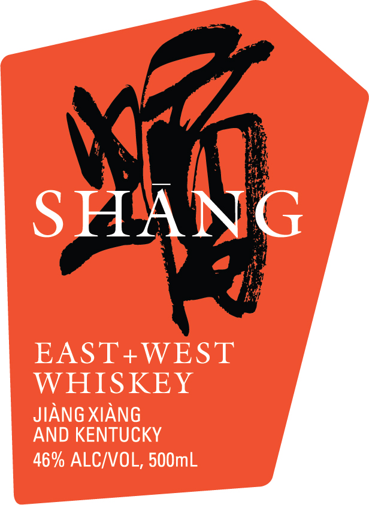

# TTB COLA Label Images - TTBID 26303001000415

**Brand Name:** SHANG

**Fanciful Name:** EAST + WEST

**Issue Date:** 11/04/2026

**Origin Code:** 22

**Product Class/Type:** 140

**Source:** [TTB Public COLA Registry](https://ttbonline.gov/colasonline/viewColaDetails.do?action=publicFormDisplay&ttbid=26303001000415)

## Label Images

### Back Label

### Front Label

### Label 2

## Extracted Label Text

*Text extracted via OCR - may contain errors*

*1 image(s) excluded: text did not meet readability threshold*

**Detected Proof:** 92

### Back Label

SHANG EAST+WEST WITH KENTUCKY WHISKEY
DOUBLE-MATURED WHISKEY CRAFTED FROM JIANG XIANG
("SAUCE AROMA"
BAIJIU AGED IN CERAMIC POTS FOR AT
LEAST THREE YEARS IN GUIZHOU; CHINA, THE BAIJIU IS
RE-DISTILLED; BLENDED WITH KENTUCKY WHISKEY AND
AGED IN AMERICAN OAK CASKS
AGED FOR AT LEAST ONE MONTH:
PRODUCED BY MARITINE BRANDS, SHELBYVILLE; KY 40003
GOVERNMENT WARNING: (0) ACCORDING TO ThE SURGEON
GENERAL; WOMEN SHOULD NOT DRINK ALCOHOLIC BEVERAGES
DURING PREGNANCY BECAUSE OF THE RISKS OF BIRTH DE-
FECTS,
(2)
CONSUMPTLON
OF
ALCOHOLIC
BEVERAGES
IMPAIRS   YOUR  ABILITY  tO   DRIVE
A
CAR OR OPERATE
MAChINERY, AND MAY CAUSE HEALTH PROBLEMS,
ME ,HI; NY 5c CT, OR 1Oc CA CRV
TRUE
ESSENCE

### Front Label

ShakG
EAST+WEST
WHISKEY
JIANG XIANG
AND KENTUCKY
46% ALC/VOL, 500mL
