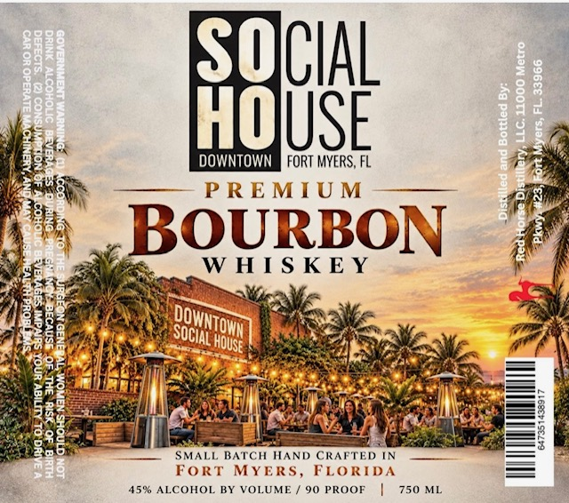

# TTB COLA Label Images - TTBID 26303001000490

**Brand Name:** RED HORSE DISTILLERY

**Fanciful Name:** SOHO PREMIUM BOURBON WHISKEY

**Issue Date:** 11/04/2026

**Origin Code:** 16

**Product Class/Type:** 141

**Source:** [TTB Public COLA Registry](https://ttbonline.gov/colasonline/viewColaDetails.do?action=publicFormDisplay&ttbid=26303001000490)

## Label Images

### Label 1

## Extracted Label Text

*Text extracted via OCR - may contain errors*

**Detected Proof:** 90

### Label 1

1323 DOWNTOWN RINE ae

eis —__ PREMIUN

a) PREMIUM 4am
We. salges WHISKEY t
BA ead RENT Wears
CRE Bo re ae fee. OS
7 pier 1 MM al Oy ELM ny eM een oo i

3 SMALL BATCH HAND CRAFTED IN —*

j FORT MYERS, FLORIDA => Fs
es 45% ALCOHOL BY VOLUME /90 PROOF | 750 ML a
