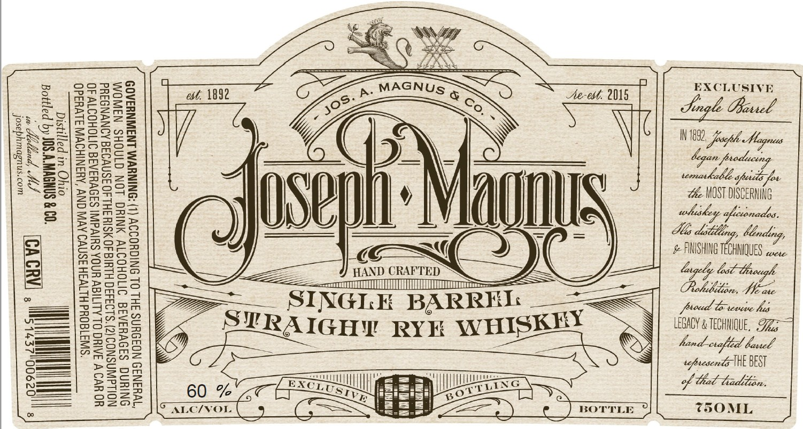

# TTB COLA Label Images - TTBID 26303001000492

**Brand Name:** JOSEPH MAGNUS

**Fanciful Name:** SINGLE BARREL STRAIGHT RYE WHISKEY

**Issue Date:** 11/04/2026

**Origin Code:** 06

**Product Class/Type:** 102

**Source:** [TTB Public COLA Registry](https://ttbonline.gov/colasonline/viewColaDetails.do?action=publicFormDisplay&ttbid=26303001000492)

## Label Images

### Label 1

## Extracted Label Text

*Text extracted via OCR - may contain errors*

### Label 1

DS

eevee

ocoxrMse

sna

ie

mpmS

Eoin

et, \892

p. MAGNUs @

Ae-vt. 2015

EXCLUSIVE

Sse.

ASoSzZz

o2mz

308

eagle Privsel —

os

==

=SSunm

\

IN 1882,

Ss

Ao.

Raowos

aes aoe

GY

ar

205535

Se

oe

=

2)

BUG

22S =

seUs

Q_

tmukebly

i

=S

LOonmstn

Soon

\;

q

Snzo0 >

VU)

Ze MOST DISCERNING

BUZZE

Zemnz—

l]

Ul

—<PRAQ

EoaezZ

SRorsS

SU /

Mas ditdlng, Mending

# FINISHING TECHNIQUES ccs.

BAxBo

mOBOS

@)

=zosara

Prot

a

HAND CRAPTED

=

——<

=a

Semag

EZEGES

a

= TOM

Tm

cm

Om

oS

—

So 2

Gm

moe

yr

INGLE BARRE

oS

Doy

mSoF

Raw

LEGAGY & TECHNIQUE, Ti

226002

Az=smeo

RAIGHY RYE WHISKE

hand-crafted basel

re g®2

=

soprecenteWEBEST

Sa

o=2

==

i

feiepos ocMla,

Te

oT]

|

|

|

=

ee

of tet tadtion,

DW20-

oSs2sb

=

pee

TSOML

Le

Age BOTTLE

7
