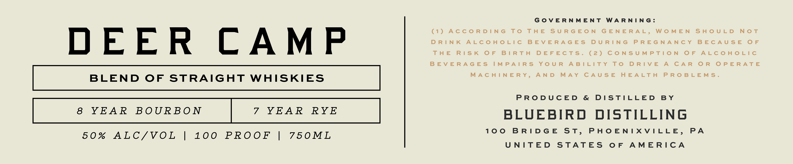
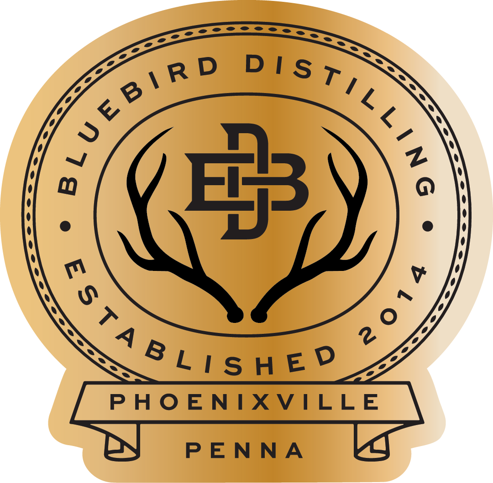

# TTB COLA Label Images - TTBID 26303001000575

**Brand Name:** BLUEBIRD DISTILLING

**Fanciful Name:** DEER CAMP

**Issue Date:** 11/05/2026

**Origin Code:** 39

**Product Class/Type:** 120

**Source:** [TTB Public COLA Registry](https://ttbonline.gov/colasonline/viewColaDetails.do?action=publicFormDisplay&ttbid=26303001000575)

## Label Images

### Label 1

### Label 2

### Label 3

## Extracted Label Text

*Text extracted via OCR - may contain errors*

*2 image(s) excluded: text did not meet readability threshold*

**Detected Proof:** 100
**Detected Age:** 8 Years

### Label 1

DEER CAMP

BLEND OF STRAIGHT WHISKIES

8 YEAR BOURBON

50% ALC/VOL

100 PROOF |

7 YEAR RYE

75OML

GOVERNMENT WARNING:
(1) ACCORDING TO THE SURGEON GENERAL, WOMEN SHOULD NOT
DRINK ALCOHOLIC BEVERAGES DURING PREGNANCY BECAUSE OF
THE RISK OF BIRTH DEFECTS. (2) CONSUMPTION OF ALCOHOLIC
BEVERAGES IMPAIRS YOUR ABILITY TO DRIVE A CAR OR OPERATE
MACHINERY, AND MAY CAUSE HEALTH PROBLEMS.

PRODUCED & DISTILLED BY

BLUEBIRD DISTILLING

100 BRIDGE ST, PHOENIXVILLE, PA
UNITED STATES OF AMERICA
