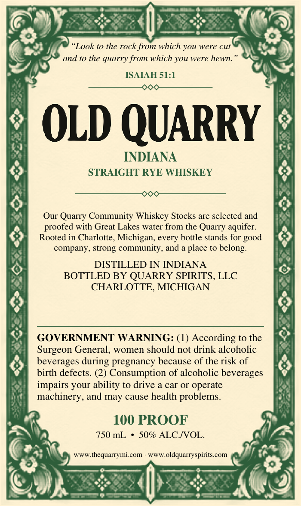
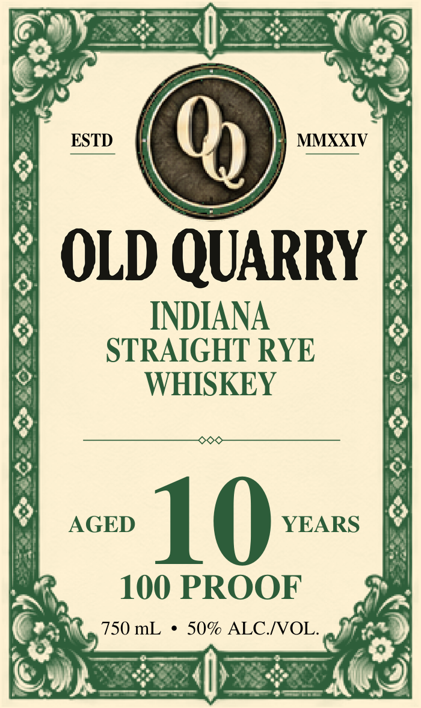

# TTB COLA Label Images - TTBID 26304001000048

**Brand Name:** OLD QUARRY

**Issue Date:** 11/04/2026

**Origin Code:** 06

**Product Class/Type:** 102

**Source:** [TTB Public COLA Registry](https://ttbonline.gov/colasonline/viewColaDetails.do?action=publicFormDisplay&ttbid=26304001000048)

## Label Images

### Back Label

### Front Label

### Label 3

## Extracted Label Text

*Text extracted via OCR - may contain errors*

**Detected Proof:** 100
**Detected Age:** 10 Years

### Back Label

Look to the rock from which you
were cut
and t0 the quarry from which you were hewn
ISAIAH 51:1
OLD QUARRY
INDIANA
STRAIGHT RYE WHISKEY
Our Quarry Community Whiskey Stocks are selected and
proofed with Great Lakes water
the Quarry aquifer:
Rooted in Charlotte, Michigan;
bottle stands for
company; strong community, and a place to belong:
DISTILLED IN INDIANA
BOTTLED BY QUARRY SPIRITS, LLC
CHARLOTTE, MICHIGAN
GOVERNMENT WARNING: (1) According t0 the
Surgeon General
women should not drink alcoholic
beverages
pregnancy because of the risk of
birth defects. (2) Consumption of alcoholic beverages
impairs your ability to drive a car Or operate
machinery, and may cause health problems_
100 PROOF
750 mL
509 ALC NOL
WwW.thequarrymi com
WwWoldquarryspirits.com
from
good
every
during

### Front Label

ESTD
0
MMXXIV
OLD QUARRY
INDIANA
STRAIGHT RYE
WHISKEY
AGED
10
YEARS
100 PROOF
750 mL
50% ALCIVOL.

### Label 3

eat)
fee
oe
bi 10040 4
Jooik
_s

Bsuvaas
BOLI
by CaOV i
ey > e
t Awan
iy (10

=>
<=O=>
p ISAIAH
b 51:1

fat
Suei
