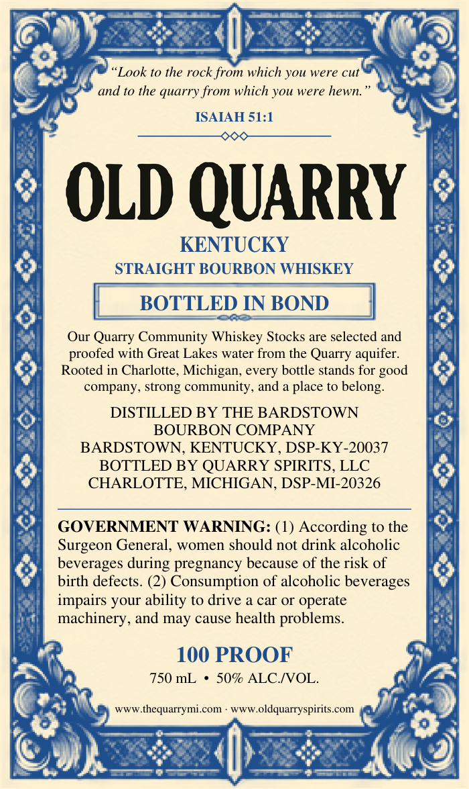
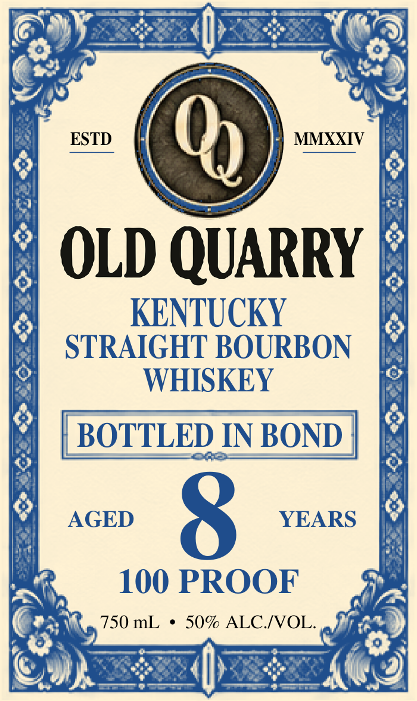
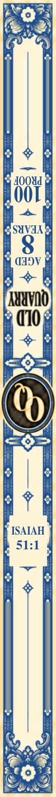

# TTB COLA Label Images - TTBID 26304001000052

**Brand Name:** OLD QUARRY

**Issue Date:** 11/05/2026

**Origin Code:** 06

**Product Class/Type:** 111

**Source:** [TTB Public COLA Registry](https://ttbonline.gov/colasonline/viewColaDetails.do?action=publicFormDisplay&ttbid=26304001000052)

## Label Images

### Back Label

### Front Label

### Label 3

## Extracted Label Text

*Text extracted via OCR - may contain errors*

*1 image(s) excluded: text did not meet readability threshold*

**Detected Proof:** 100
**Detected Age:** 8 Years

### Back Label

Look to the rock from which you
were cut
and t0 the quarry from which you were hewn
ISAIAH 51:1
OLD QUARRY
KENTUCKY
STRAIGHT BOURBON WHISKEY
BOTTLED IN BOND
Our Quarry Community Whiskey Stocks are selected and
proofed with Great Lakes water
the Quarry aquifer:
Rooted in Charlotte, Michigan,
bottle stands for
company; strong community, and a place to belong:
DISTILLED BY THE BARDSTOWN
BOURBON COMPANY
BARDSTOWN,
KENTUCKY, DSP-KY-20037
BOTTLED BY QUARRY SPIRITS, LLC
CHARLOTTE, MICHIGAN, DSP-MI-20326
GOVERNMENT WARNING: (1) According t0 the
Surgeon General
women should not drink alcoholic
beverages
pregnancy because of the risk of
birth defects. (2) Consumption of alcoholic beverages
impairs your ability to drive a car O operate
machinery, and may cause health problems_
100 PROOF
750 mL
509 ALC NOL
Www.thequarrymi com
WwWoldquarryspirits.com
from
good
every
during

### Front Label

ESTD
0
MMXXIV
OLD QUARRY
KENTUCKY
STRAIGHT BOURBON
WHISKEY
BOTTLED IN BOND
AGED
8
YEARS
100 PROOF
750 mL
50% ALCIVOL.
