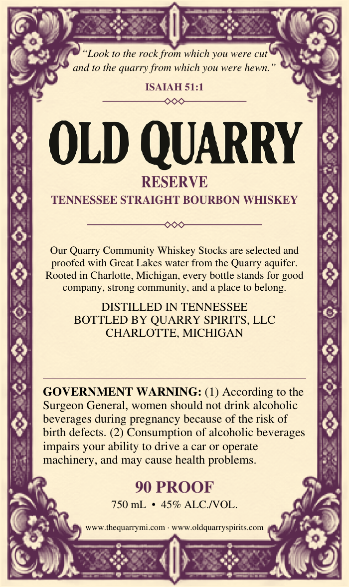
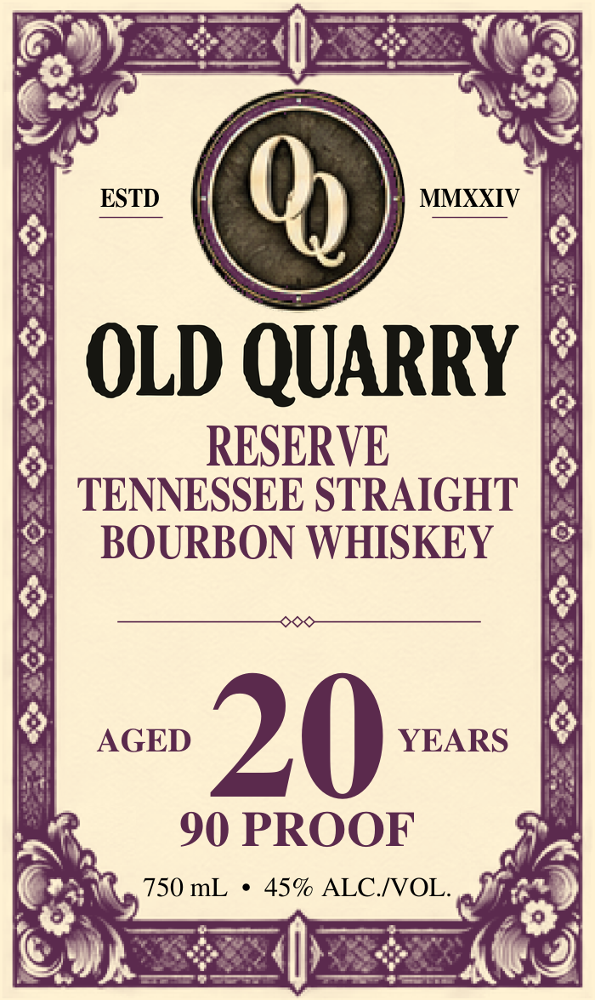
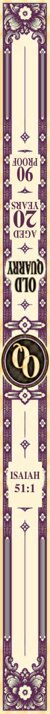

# TTB COLA Label Images - TTBID 26304001000053

**Brand Name:** OLD QUARRY

**Fanciful Name:** RESERVE

**Issue Date:** 11/04/2026

**Origin Code:** 06

**Product Class/Type:** 101

**Source:** [TTB Public COLA Registry](https://ttbonline.gov/colasonline/viewColaDetails.do?action=publicFormDisplay&ttbid=26304001000053)

## Label Images

### Back Label

### Front Label

### Label 3

## Extracted Label Text

*Text extracted via OCR - may contain errors*

*1 image(s) excluded: text did not meet readability threshold*

**Detected Proof:** 90
**Detected Age:** 20 Years

### Back Label

Look to the rock from which you
were cut
and t0 the quarry from which you were hewn
ISAIAH 51:1
OLD QUARRY
RESERVE
TENNESSEE STRAIGHT BOURBON WHISKEY
Our Quarry Community Whiskey Stocks are selected and
proofed with Great Lakes water
the Quarry aquifer:
Rooted in Charlotte, Michigan_
bottle stands for
company; strong community, and a place to belong:
DISTILLED IN TENNESSEE
BOTTLED BY QUARRY SPIRITS, LLC
CHARLOTTE, MICHIGAN
GOVERNMENT WARNING: (1) According to the
Surgeon General
women should not drink alcoholic
beverages
pregnancy because of the risk of
birth defects. (2) Consumption of alcoholic beverages
impairs your ability to drive a car Or operate
machinery, and may cause health problems_
90 PROOF
750 mL
459 ALC IOL
Www.thequarrymi com
WwWoldquarryspirits.com
from
good
every
during

### Front Label

ESTD
0
MMXXIV
OLD QUARRY
RESERVE
TENNESSEE STRAIGHT
BOURBON WHISKEY
AGED
20
YEARS
90 PROOF
750 mL
45% ALCIVOL.
