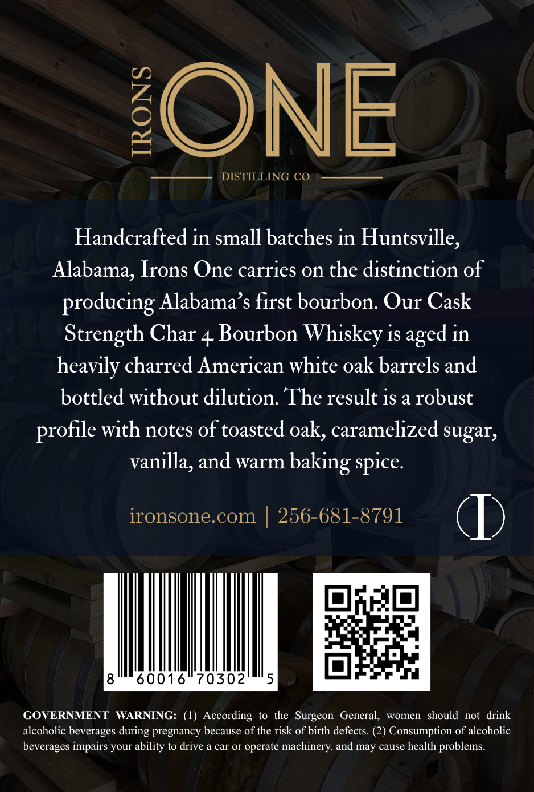
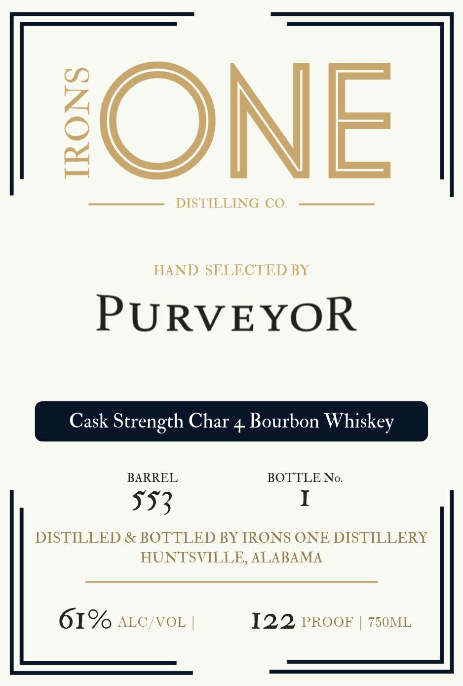

# TTB COLA Label Images - TTBID 26304001000067

**Brand Name:** IRONS ONE DISTILLERY

**Fanciful Name:** CASK STRENGTH CHAR 4 BOURBON BARREL SELECT

**Issue Date:** 11/17/2026

**Origin Code:** 10

**Product Class/Type:** 141

**Source:** [TTB Public COLA Registry](https://ttbonline.gov/colasonline/viewColaDetails.do?action=publicFormDisplay&ttbid=26304001000067)

## Label Images

### Back Label

### Label 1

## Extracted Label Text

*Text extracted via OCR - may contain errors*

**Detected Proof:** 122

### Back Label

IONE
DISTILLING CO.
Handcrafted in small batches in Huntsville,
Alabama, Irons One carries on the distinction of
producing Alabama's first bourbon: Our Cask
Strength Char 4 Bourbon Whiskey is
in
heavily charred American white oak barrels and
bottled without dilution: The result is a robust
with notes of toasted oak, caramelized sugar,
vanilla, and warm
ironsone com
256-681-8791
60016"70302
5
GOVERNMENT
WARNING: (1) According
to
the
Surgeon   General,
women   should
not   drink
alcoholic beverages during pregnancy because of the risk of birth defects. (2) Consumption of alcoholic
beverages impairs your
to drive a car Or operate
machinery;
may cause health problems
aged
profile
baking
spice
ability
and

### Label 1

2
)NE
DISTILLING CO.
HAND SELECTED BY
PURVEYOR
Cask Strength Char 4 Bourbon
Whiskey
BARREL
BOTTLE No.
553
I
DISTILLED & BOTTLED BY IRONS ONE DISTILLERY
HUNTSVILLE, ALABAMA
61% ALC VOL
I22 PROOF
750ML
