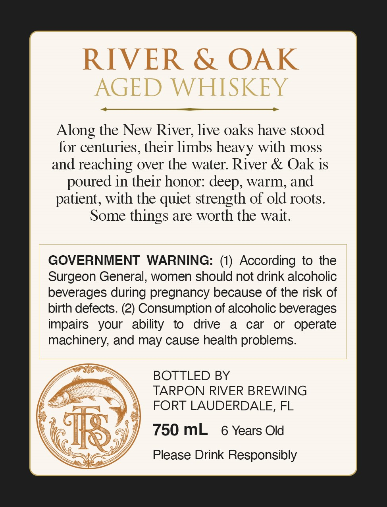
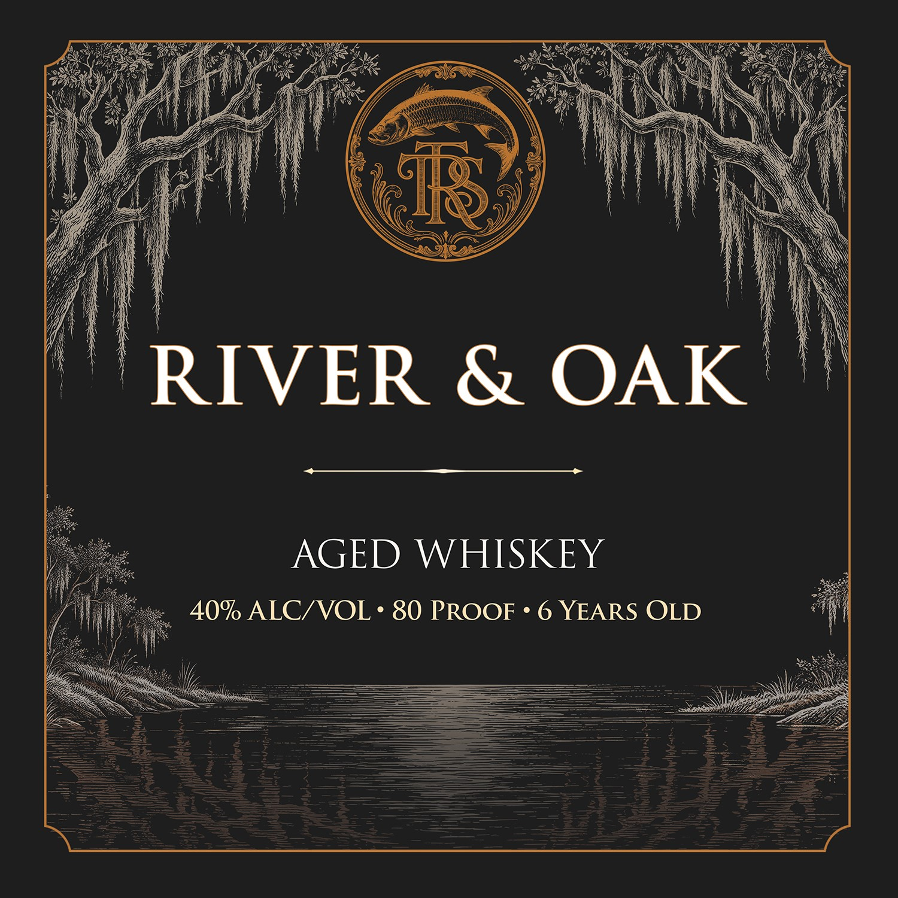

# TTB COLA Label Images - TTBID 26305001000028

**Brand Name:** TRS

**Fanciful Name:** RIVER AND OAK

**Issue Date:** 11/13/2026

**Origin Code:** 16

**Product Class/Type:** 140

**Source:** [TTB Public COLA Registry](https://ttbonline.gov/colasonline/viewColaDetails.do?action=publicFormDisplay&ttbid=26305001000028)

## Label Images

### Back Label

### Front Label

## Extracted Label Text

*Text extracted via OCR - may contain errors*

**Detected Proof:** 80
**Detected Age:** 6 Years

### Back Label

RIVER
&
OAK
AGED WHISKEY
Along the New River; live oaks have stood
for centuries, their limbs heavy with moss
and reaching over the water: River & Oak is
poured in their honor:
warm, and
patient; with the
strength of old roots
Some
are worth the wait.
GOVERNMENT
WARNING: (1) According to the
Surgeon General, women should not drink alcoholic
beverages during pregnancy because of the risk of
birth defects. (2) Consumption of alcoholic beverages
impairs
your   ability
to
drive
a
car
Or
operate
machinery; and may cause health problems:
BOTTLED BY
TARPON RIVER BREWING
FORT LAUDERDALE, FL
750 mL
6 Years Old
Please Drink Responsibly
deep;
quiet
things

### Front Label

RIVER
& OAK
AGED WHISKEY
40% ALC/VOL . 80 PROOF
6 YEARS OLD
