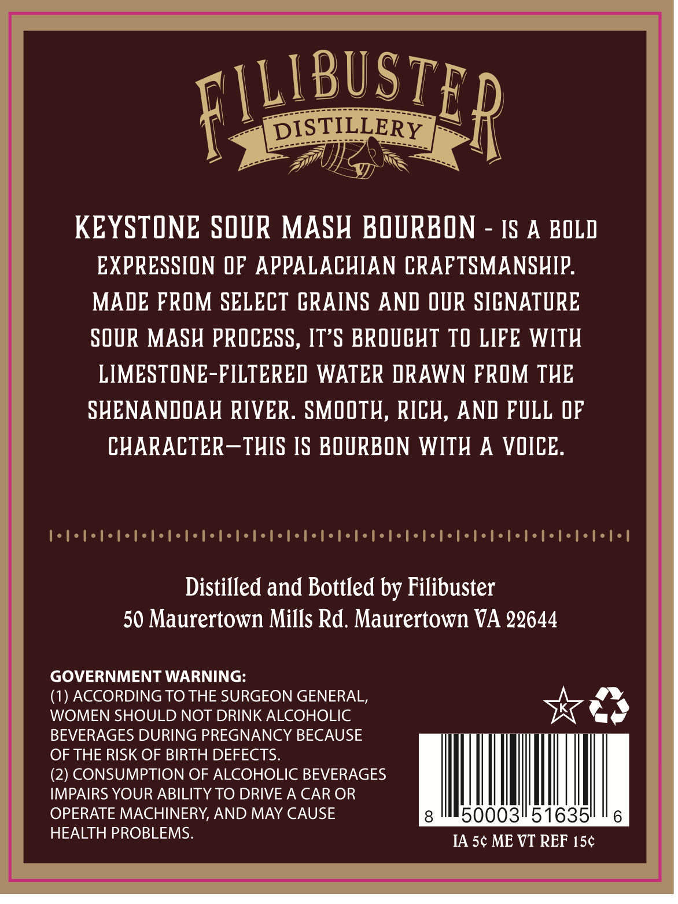
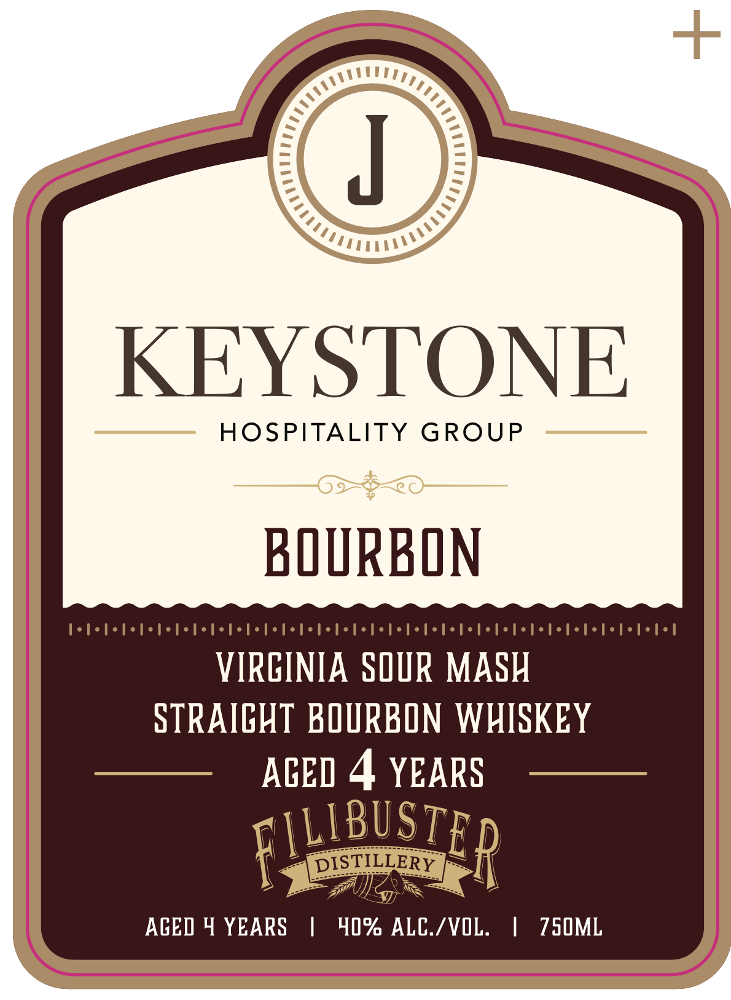

# TTB COLA Label Images - TTBID 26305001000030

**Brand Name:** KEYSTONE VIRGINIA SOUR MASH BOURBON

**Issue Date:** 11/12/2026

**Origin Code:** 05

**Product Class/Type:** 101

**Source:** [TTB Public COLA Registry](https://ttbonline.gov/colasonline/viewColaDetails.do?action=publicFormDisplay&ttbid=26305001000030)

## Label Images

### Back Label

### Front Label

## Extracted Label Text

*Text extracted via OCR - may contain errors*

**Detected Age:** 4 Years

### Back Label

F
[LBVSTER
DISTILLERY
KEYSTONE SOUR MASH BODRBON
IS A BOLD
EXPRESSION OF APPALACHIAN CRAFTSMANSHIP
MADE FROM SELECT CRAINS AND ODR SICNATURE
SOUR MASH PROCESS, IT S BROUCHT TO LIFE WITH
LIMESTONE-FILTERED WATER DRAWN FROM THE
SHENANDOAH RIVER. SMOOTH, RICH, AND FULL OF
CHARACTER_THIS IS ROURRON WITH A VOICE.
Distilled and Bottled by Filibuster
50 Maurertown Mills Rd. Maurertown VA 22644
GOVERNMENT WARNING:
(1) ACCORDING TO THE SURGEON GENERAL,
WOMEN SHOULD NOT DRINK ALCOHOLIC
BEVERAGES DURING PREGNANCY BECAUSE
OF THE RISK OF BIRTH DEFECTS.
(2) CONSUMPTION OF ALCOHOLIC BEVERAGES
IMPAIRS YOUR ABILITY TO DRIVE A CAR OR
OPERATE MACHINERY, AND MAY CAUSE
500031/516351
6
HEALTH PROBLEMS.
IA 5c ME VT REF 15c

### Front Label

+
KEYSTONE
HOSPITALITY GROUP
ROURBON
VIRCINIA SOUR MASH
STRAICHT ROURRON WHISKEY
ACED 4 YEARS
FLYBUSTER
DISTILLERY
ACED 4 YEARS
4o% ALC_/VOL.
750ML
