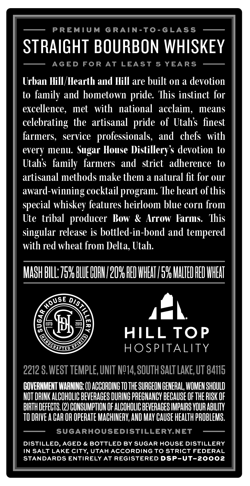
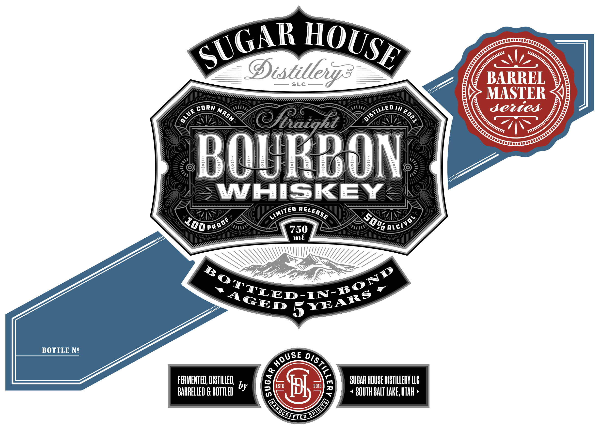
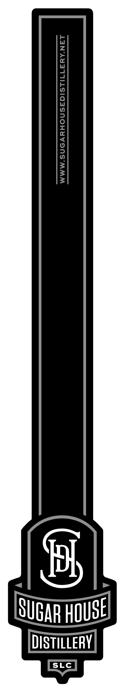

# TTB COLA Label Images - TTBID 26305001000085

**Brand Name:** SUGAR HOUSE DISTILLERY

**Issue Date:** 11/04/2026

**Origin Code:** 45

**Product Class/Type:** 111

**Source:** [TTB Public COLA Registry](https://ttbonline.gov/colasonline/viewColaDetails.do?action=publicFormDisplay&ttbid=26305001000085)

## Label Images

### Back Label

### Front Label

### Label 3

## Extracted Label Text

*Text extracted via OCR - may contain errors*

*1 image(s) excluded: text did not meet readability threshold*

**Detected Age:** 5 Years

### Back Label

PREMIUM
GRAIN-To-GLASS
STRAIGHT BOURBON WHISKEY
AGED
FoR
AT
LEAST
5
YEARS
Urban Hill /Hearth and Hill are built 0n a devotion
to
family and hometown
This instinct for
excellence,
met
with
national   acclaim,
means
celebrating the artisanal
of Utahs finest
farmers,
service
professionals,
and  chefs   with
every menu:
Sugar House Distillerys devotion to
Utahs
family  farmers   and
strict   adherence
to
artisanal methods make them a natural fit for our
award-winning cocktailprogram: Theheart ofthis
special whiskey features heirloom blue corn from
Ute tribal  producer  Bow
Arrow Farms.   This
singular release is bottled-in-bond and tempered
with red wheat from Delta, Utah:
MaSH BILL7596 BLUEHOHI/2OY HED IHEAT /59 HHLTED HE HHEHT
k
ESTD
Jbj
2013
HILL TOP
HOSPITALITY
2212 $,WEST TEMPLE, UNIT NQ14,SOUTH SALT LAKE, UT 84115
GOVERNMEHT IARNING: (1) ACCORDING TO THE SURCEOH GENERAL; IOMEN SHOULD
NOT DRINK ALCOhOLIC BEVERAGeS DURING PRECHANCV beCauSe OF the RSK OF
BIRTH DEFECTS (2) COHSUMPTIOH OF ALCOHOLIC BEVERAGES IMPAIRS VOUR ABILITY
TO DRIVE A CAR OR OPERATE MACHINERY; AND MaY CAuSe HEaLTH PROBLEMS;
SUGARHOUSEDISTILLERYNET
DISTILLED, AGED & BOTTLED BY SUGAR HOUSE DISTILLERY
IN SALT LAKE CITY, UTAH ACCORDING TO STRICT FEDERAL
STANDARDS ENTIRELY AT REGISTERED DSP-UT-20002
pride
pride
HouSe
DIS;

CRALIED

### Front Label

@istillevz
SL
BARREL
MASTER
cORN
IN
semied
taiqhz
BOURBON
WHISKEY
XO0pnoof
750
me
#O{TLED-IN-1g?
5
48k5nlNElis
BOTTLE Ne
FERHEHTED, DISTILLED;
SUBAR HOUBE DISTILLERY LL}
BHRAELLED G BUTTED by
ESTD
Jl
2013
3
SOUTH SALT LAKE, UTah
SUGAR
HOUSE
~DistiLleo
Mash '
BLuE
1
LimitEd
RELEASE
509
ALCIVO
HOUSE
DiStill _

QanochaELeo
SPIRTTS
