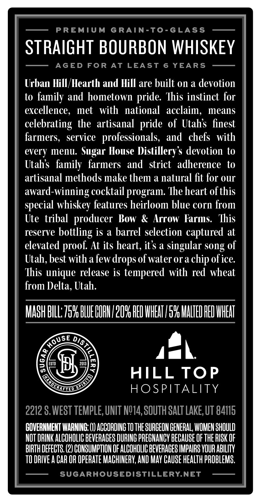
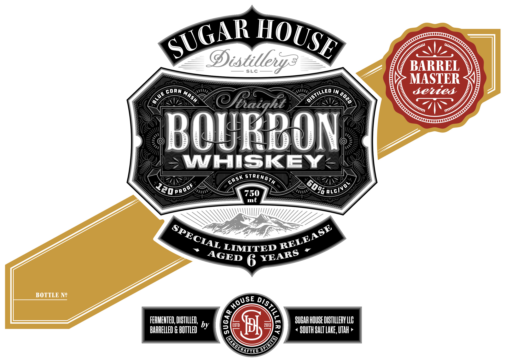
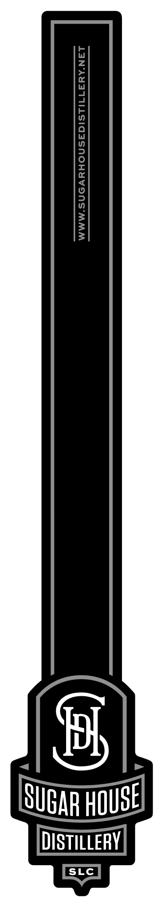

# TTB COLA Label Images - TTBID 26305001000086

**Brand Name:** SUGAR HOUSE DISTILLERY

**Issue Date:** 11/04/2026

**Origin Code:** 45

**Product Class/Type:** 101

**Source:** [TTB Public COLA Registry](https://ttbonline.gov/colasonline/viewColaDetails.do?action=publicFormDisplay&ttbid=26305001000086)

## Label Images

### Back Label

### Front Label

### Label 3

## Extracted Label Text

*Text extracted via OCR - may contain errors*

*1 image(s) excluded: text did not meet readability threshold*

**Detected Age:** 6 Years

### Back Label

PREMIUM
GRAIN-To-GLASS
STRAIGHT BOURBON WHISKEY
AGED
FOR AT
LEAST
6
YEARS
Urban Hill /Hearth and Hill are built 0n a devotion
to family and hometown
Ihis instinct for
excellence,
met
with
national   acclaim,
means
celebrating the artisanal
of Utahs finest
farmers,
service
professionals,
and   chefs
with
every menu: Sugar House Distillerys devotion to
Utahs  family  farmers  and
strict   adherence
to
artisanal methods make them a natural fit for our
award-winning cocktailprogram: The heart ofthis
special whiskey features heirloom blue corn from
Ute   tribal
producer  Bow
Arrow  Farms:
This
reserve
bottling is a barrel selection captured at
elevated proof At its heart, its a singular song of
Utah, best with afew drops ofwater or a chip ofice
This unique release is tempered with red wheat
from Delta, Utah:
MASh BILL759 BLUEUOHL/2OY HED HHEAT /59 HHLTED HED HHEHT
8
g
EST
#5
2013
HILL TOP
HOSPITALITY
2212 $,WEST TEMPLE, UNIT NQ14, SQUTH SALT LAKE, UT 84115
GOVERNMEHT WARNING; (1) ACCORDING TO THE SURCEOH GENERAL; WOMEN SHOULD
NOT DRINK ALCOHOLIC BEVERACES DURING PRECHaNCY BECAUSE OF THE RISK OF
BIRTH DEFECTS (2) COHSUMPTION OF ALCOHOLIC BEVERAGES IMPAIRS YOUR ABILITV
TO DRIVE A CAR OR OpeRATe MACHINERV; AND MAV CAuSE HEALTH PROBLEMS;
SUGARHOUSEDISTILLERY.NET
pride
pride
HOUSe
DISF
1
cRLEiDD

### Front Label

Distilleys
SLC
BARREL
MASTER
corN
IN
semied
haiqhl
BOURBON
WHISKEY
X20pnoo
750
ml
LIMITED
6
BOTTLE NQ
FERMEHTED; DISTILLED;
7
SUBARHOUSE DBTHLLERY LL6
BARRELLED G BUTTLED by
0
ESTD
pf
2013
2
SOUTH SALT LAKE, UTah
SUGAR
HOUSE
Wu
DISTiLled
MASH
BLuE
2
STRENGTH
cASK
6090
ALCIVO
SPECIAL
RELEASE
YEARS
AGED
HoUSe
DISTIL =
C
SPIRIISI
NDCRAEIEO
