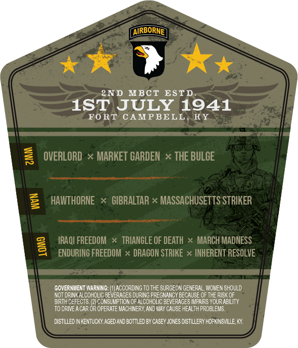
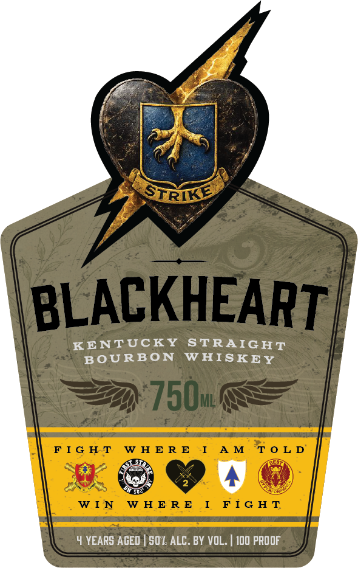

# TTB COLA Label Images - TTBID 26306001000016

**Brand Name:** BLACKHEART

**Issue Date:** 11/04/2026

**Origin Code:** 22

**Product Class/Type:** 101

**Source:** [TTB Public COLA Registry](https://ttbonline.gov/colasonline/viewColaDetails.do?action=publicFormDisplay&ttbid=26306001000016)

## Label Images

### Back Label

### Front Label

## Extracted Label Text

*Text extracted via OCR - may contain errors*

**Detected Proof:** 100
**Detected Age:** 4 Years

### Back Label

AIRBORNE
2ND MBCT
ESTD
1ST JULY 1941
FORT
CAMPBELL
KY
3
OVERLORD
MARKET GARDEN x THE BULCE
HAITHORNE
GIBRALTAR x MASSACHUSETTS STRIKER
IRAQI FREEDOM
TRIANGLE OF DEATH
MARCH MADNESS
4
ENDURING FREEDOM
DRAGON STRIKE
INHERENT RESOLVE
GOVERNMENT MARNING:
ACCORDING TO THE SURGEON GENERAL, WOMEN SHOULD
NOT DRINK ALCOHOLIC DEVERACES DURING FREGNANGY BECAUSE OF THE RISK QF
BRTHDEFECTS
CONSUMPTION OF ALCOHOLIC BEVERACES MFAIRS YOUR ABILITY
TO DRIVEACAR
OR
OPERATE MACHINERY, AND MAY CAUSE HEALTH FROBLEMS
DISTLLED IN KENTUCKY AGED ANd BottLeD BY CASEY JONES DISTLLERY HOPKLNSVILLE, KY
0

### Front Label

rs
= $
(ame
KENTUCKY STRAIGHT
BOURBON WHISKEY
ED
Rosh
4 YEARS AGED | $07. ALC. BY VOL. | 100 PROOF
