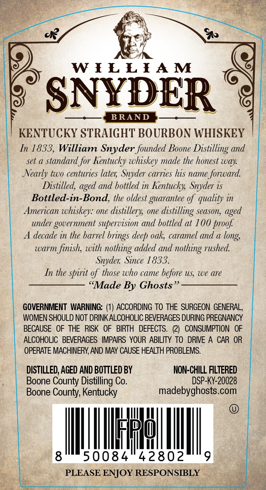
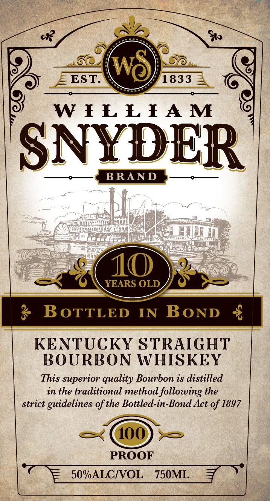
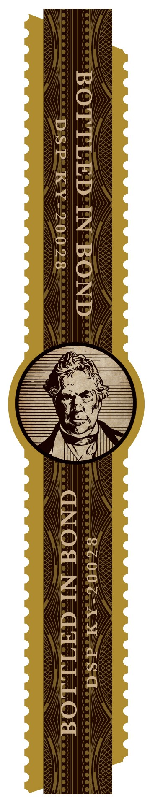

# TTB COLA Label Images - TTBID 26306001000055

**Brand Name:** WILLIAM SYNDER

**Fanciful Name:** BOTTLED IN BOND

**Issue Date:** 11/04/2026

**Origin Code:** 22

**Product Class/Type:** 111

**Source:** [TTB Public COLA Registry](https://ttbonline.gov/colasonline/viewColaDetails.do?action=publicFormDisplay&ttbid=26306001000055)

## Label Images

### Back Label

### Front Label

### Label 3

## Extracted Label Text

*Text extracted via OCR - may contain errors*

**Detected Proof:** 100
**Detected Age:** 10 Years

### Back Label

W FE EFAM
SNYDER
BRAND
KENTUCKY STRAIGHT BOURBON WHISKEY
In 1833, William Snyder founded Boone Distilling and
set a standard_for Kentucky whiskey made the honest way
Nearly two centuries later; Snyder carries his name forward
Distilled,
and hottled in Kentucky;  Snyder is
Bottled-in-Bond, the oldest guarantee %f quality in
American whiskey: one distillery; one
distilling
season;
aged
under government supervision and bottled at 100 proof
decade in the barrel
deep oak; caramel and a
warm finish, with
added and
rushed
Snyder: Since 1833.
In the spirit gf those who came before US we are
"Made By Ghosts
GOVERNMENT WARNING:
ACCORDING To THE  SURGEON  GENERAL,
WOMEN SHOULD NOT DRINK ALCOHOLIC BEVERAGES DURING PREGNANCY
BECAUSE   OF THE  RISK   OF
BIRTH  DEFECTS.
(2)
CONSUMPTION
OF
ALCOHOLIC   BEVERAGES   IMPAIRS YOUR ABILITY TO
DRIVE A
CAR  OR
OPERATE MACHINERY, AND MAY CAUSE HEALTH PROBLEMS.
DISTILLED, AGED AND BOTTLED BY
NON-CHILL FILTERED
Boone County Distilling Co.
DSP-KY-20028
Boone County; Kentucky
madebyghosts.com
8
50084
42802
PLEASE ENJOY RESPONSIBLY
aged =
brings
long;
nothing
nothing

### Front Label

EST:
1833
W FE EfA M
SNYDER
BRAND
10
YEARS OLD
BoTTLED
IN
BoND
KENTUCKY STRAIGHT
BOURBON WHISKEY
This superior quality Bourbon is distilled
in the traditional method following the
strict
guidelines of the Bottled-in-Bond Act of 1897
100
PROOF
50%ALCIVOL
750ML
Wo_

### Label 3

BOTTLED IN BOND ~(4tnw Eveesevereveceseuerts

DSP:KY: 700-28 Pe Lane? GQNO@P NEGATE LOS
