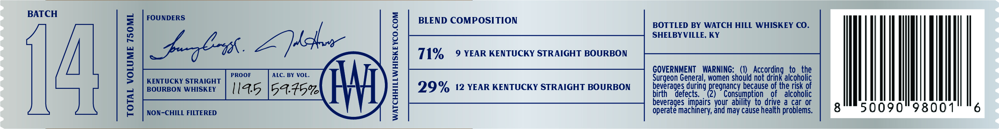

# TTB COLA Label Images - TTBID 26306001000096

**Brand Name:** WATCH HILL

**Fanciful Name:** KENTUCKY STRAIGHT BOURBON WHISKEY

**Issue Date:** 11/04/2026

**Origin Code:** 22

**Product Class/Type:** 101

**Source:** [TTB Public COLA Registry](https://ttbonline.gov/colasonline/viewColaDetails.do?action=publicFormDisplay&ttbid=26306001000096)

## Label Images

### Front Label

## Extracted Label Text

*Text extracted via OCR - may contain errors*

**Detected Age:** 9 Years

### Front Label

BATCH

TOTAL VOLUME 750ML

FOUNDERS

KENTUCKY STRAIGHT

BOURBON WHISKEY

NON-CHILL FILTERED

WATCHHILLWHISKEYCO.COM

BLEND COMPOSITION

71% 9 YEAR KENTUCKY STRAIGHT BOURBON

29% 12 YEAR KENTUCKY STRAIGHT BOURBON

BOTTLED BY WATCH HILL WHISKEY CO.
SHELBYVILLE, KY

GOVERNMENT WARNING: (1) According to the
Surgeon General, women should not drink alcoholic
beverages during pregnancy because of the risk of
birth defects. (2) Consumption of alcoholic

beverages impairs your ability to drive a car or

operate machinery, and may cause health problems.

WM
